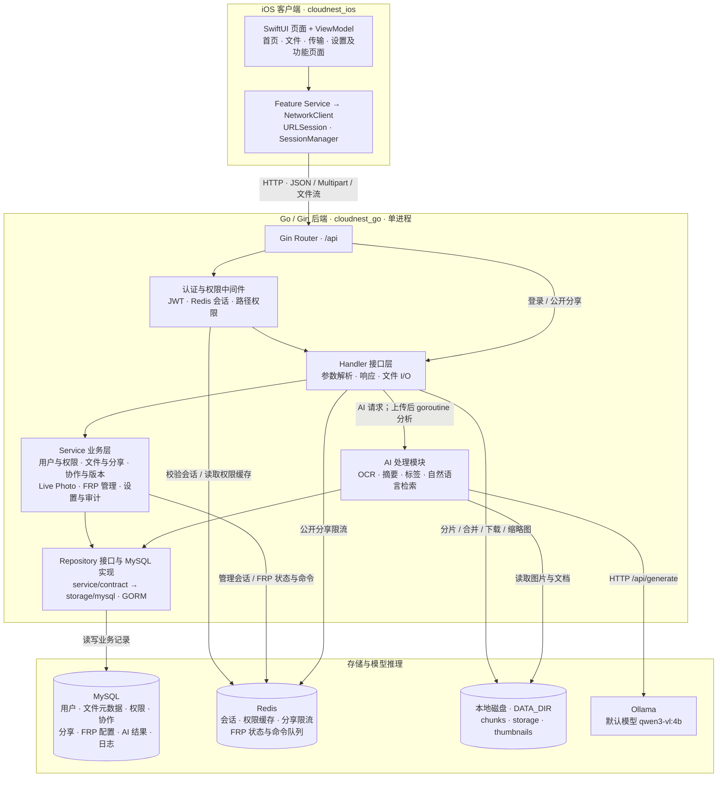

# CloudNest 系统架构图

依据 2026-09-08 当前工作区源码整理，包含未提交的客户端改动。此图描述代码结构与依赖关系，不代表已经核验实际运行环境。

## 总体架构

CloudNest 采用 SwiftUI iOS 客户端与 Go/Gin 分层单体后端。后端框内的节点是同一进程中的逻辑模块；MySQL、Redis 和 Ollama 是独立依赖。本地磁盘保存文件内容。

箭头表示调用或数据访问方向，响应沿请求链路返回。主图省略模块间的辅助调用；AI 节点概括 AIService 以及文件上传入口中的分析编排。

## 目录与职责

| 路径（相对项目根目录） | 职责 |
| --- | --- |
| `cloudnest_ios/cloudnest_ios/Features` | 按功能组织 Views、ViewModels、Models、Services；包括 Auth、Home、Files、Transfers、Settings、Profile、FRP、Smart、AdminLogs。 |
| `cloudnest_ios/cloudnest_ios/Core/Network` | Endpoint、请求协议、URLSession 客户端与错误处理。 |
| `cloudnest_ios/cloudnest_ios/App/DependencyInjection` | AppContainer 组装环境配置与网络客户端。 |
| `cloudnest_ios/cloudnest_ios/Shared/Managers` | 会话保存与应用事件。 |
| `cloudnest_go/cmd/server` | 加载配置、初始化 MySQL / Redis、启动 HTTP 服务。 |
| `cloudnest_go/internal/app` | 依赖注入与路由注册。 |
| `cloudnest_go/internal/middleware`、`internal/auth` | JWT、会话有效性、路径权限与管理员校验。 |
| `cloudnest_go/internal/handler` | HTTP 接口；FileHandler 还承担磁盘 I/O、分片合并、分享限流和自动分析触发。 |
| `cloudnest_go/internal/service` | 业务逻辑、权限判断、事务编排与 Ollama 调用。 |
| `cloudnest_go/internal/service/contract` | Repository 和事务等抽象接口。 |
| `cloudnest_go/internal/storage/mysql` | GORM 仓储实现。 |
| `cloudnest_go/internal/store`、`model` | 数据库与 Redis 连接、模型与自动建表。 |
| `cloudnest_go/data` | 默认文件数据目录，可用 DATA_DIR 或启动参数覆盖。 |
| `cloudnest_macos` | 当前为空目录，未发现独立 macOS 客户端实现。 |

## 关键数据流

1. **普通请求**：View → ViewModel → Feature Service → URLSession → Gin → 认证与权限中间件 → Handler → Service → Repository → MySQL。登录和公开分享路由直接进入对应 Handler。
2. **文件上传**：初始化任务 → 写入磁盘分片 → 合并文件并校验 → 写入文件与存储记录 → 清理分片 → 后台 goroutine 自动分析。文件内容保存在磁盘，MySQL 保存路径、大小、哈希和关联信息。
3. **AI 处理**：读取文件 → 提取图片或文档内容 → 调用 Ollama → 将标签、描述、OCR 文本和任务记录写回 MySQL。自然语言搜索生成查询条件，再通过 MySQL 字段过滤与 LIKE 查询执行检索。
4. **FRP 控制**：管理接口保存设备、映射和配置到 MySQL；部署 / 重载命令进入 Redis List。预期由设备端通过 HTTP 接口拉取命令、上报状态和执行结果，设备端不直接连接 Redis。

## 实现边界

- 后端是分层单体，图中的业务模块没有独立部署。
- FRP 设备 Agent 实现不在当前仓库；此处仅确认服务端管理与命令交互接口，未将 FRP 穿透链路画成已运行设施。
- AI 自动分析使用进程内 goroutine；Redis List 用于 FRP 命令，不承担 AI 分析队列。
- 智能检索基于模型生成条件和 MySQL 查询，当前没有向量数据库或 Embedding 检索链路。
- 当前源码未发现独立 Web / Android 客户端、对象存储接入或容器编排配置。
- HTTP 服务由 Gin 直接启动；HTTPS 终止及反向代理属于部署配置，本次未从源码确认。

## 核对入口

- `cloudnest_go/internal/app/container.go`：后端模块装配、公开接口和鉴权路由。
- `cloudnest_go/internal/middleware/auth.go`：JWT、Redis 会话和路径权限。
- `cloudnest_go/internal/handler/file_handler.go`：文件目录、分片上传、磁盘处理与异步分析。
- `cloudnest_go/internal/service/ai_service.go`：文件读取、Ollama 请求和 AI 业务。
- `cloudnest_go/internal/storage/mysql/ai_repo.go`：AI 结果存储与实际搜索方式。
- `cloudnest_go/internal/service/frp_service.go`：Redis 命令队列、设备状态和命令结果。
- `cloudnest_go/internal/config/config.go`：端口、数据目录和模型默认配置。
- `cloudnest_ios/cloudnest_ios/ContentView.swift`：当前主导航。
- `cloudnest_ios/cloudnest_ios/Core/Network/URLSessionNetworkClient.swift`：统一 HTTP 请求。
- `cloudnest_ios/cloudnest_ios/Features/Files/Services/FilesService.swift`：文件接口和客户端调用。
