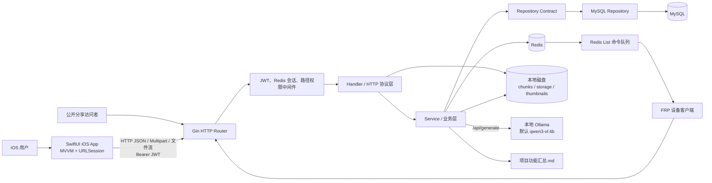

# CloudNest AI 项目记忆（Project Memory）

> 文档用途：这是 CloudNest 的长期 AI 上下文入口。后续 AI 在开始分析、设计或修改项目前，应先完整阅读本文，再按任务需要查阅源码和专项文档。
>
> 当前基线日期：2026-07-27  
> 事实基线：2026-07-25 审计的当前工作区代码、`项目理解文档.md`、`cloudnest_go/docs/API接口文档_iOS.md`、`cloudnest_go/go.mod`、`cloudnest_go/.env.example`、项目根目录说明文档、`项目功能汇总.md`，以及 `/Users/xingyuzhao/Desktop/cloudnest.sql`。  
> 可信度边界：本文严格区分“源码已实现”“客户端已接入”“文档规划”“尚无证据”。代码存在且可编译，不等于经过真机、生产环境、性能或安全验收。

## 文档维护规则

1. 本文是增量维护文档，不应在每次需求中重新生成。项目发生变化时，在现有章节中更新事实，并在文末“变更记录”追加一条记录。
2. 更新前必须核对代码、路由、数据库 migration/SQL、配置和客户端调用；不能仅根据需求描述把功能标记为完成。
3. “已完成”至少表示存在完整代码路径；如果只完成后端、只完成 iOS 封装或只有占位 UI，必须明确标注范围。
4. 新增、删除或修改 API 时，要同步更新“核心接口”“模块职责”“重要类说明”和接口数量。
5. 数据库变更必须同时核对 SQL、GORM model、AutoMigrate、Repository 和历史数据迁移，不能只更新表结构描述。
6. 新增 AI 能力时，要明确模型、输入、Prompt、数据落点、失败策略、检索方式和是否真的使用 Embedding/RAG，禁止把普通 Prompt 注入称为 RAG。
7. 所有未得到源码或用户确认的信息放入“待确认问题”，不得补写为项目事实。
8. 本文不得保存密码、token、数据库口令、JWT secret 等秘密；只记录配置键和安全要求。

---

# 1. 项目背景

## 1.1 项目名称与定位

项目名称为 **CloudNest**。Go module 的实际名称写作 `cloudenest_go`，iOS 工程名为 `cloudnest_ios`，后续修改 import、构建脚本或发布名称时需要注意这个拼写差异。

CloudNest 是一个以私有部署、自托管和移动端访问为主要形态的云文件管理系统。当前系统由 SwiftUI iOS 客户端、Go HTTP 服务、MySQL、Redis、本地磁盘文件存储和本地 Ollama AI 服务组成。它不只是简单的文件上传下载程序，还覆盖权限、分享、协作、文件版本、回收站、操作审计、Live Photo、FRP 设备管理和 AI 文件理解。

现有实现主要解决以下问题：

- 让个人、家庭或小团队把文件集中保存到自己的服务器，而不是依赖公共云盘。
- 在 iPhone 上完成目录浏览、分片上传、下载、预览、搜索、分享、移动、复制和回收站管理。
- 通过路径权限、文件权限、管理员角色和工作区成员关系控制访问范围。
- 通过 SHA-256 内容哈希复用相同物理文件，减少重复存储。
- 通过本地 Ollama 模型完成图片 OCR、EXIF 信息补充、文档摘要、自动标签和自然语言文件检索。
- 把照片文件和对应 MOV 文件绑定为 Live Photo，并在 iOS 端展示或保存到系统相册。
- 管理 FRP 设备、映射和配置，通过 Redis 队列向设备交付部署或重载命令。

## 1.2 用户与角色

当前代码能够识别的使用主体包括：

- **普通用户**：登录、管理本人文件、访问显式授权的文件、创建分享、使用个人速率时间窗。
- **管理员**：创建用户、分配路径权限、维护全局设置、查看全量日志。管理员身份来源于用户与角色表，并写入 JWT claims。
- **工作区成员**：以 `owner`、`admin` 或 `member` 身份加入 workspace。工作区角色主要用于成员管理，文件访问仍主要依赖文件所有权和 `file_permission`。
- **FRP 设备客户端**：轮询命令、上报在线状态和执行结果。当前使用普通用户 JWT，没有独立设备凭据。
- **公开分享访问者**：无需登录，通过分享码查看分享信息或下载单文件、目录 ZIP。

当前材料没有评分、打分、排行榜等领域对象、数据库表或 API；任何后续 AI 都不应假定项目包含“评分流程”。

## 1.3 当前成熟度判断

项目当前更接近“功能面较完整、正在收口的可编译 MVP/原型”，不能仅凭仓库认定为生产就绪：

- Go 后端注册 83 条 HTTP 路由，主要业务均存在实现。
- `go test ./...` 能通过，但所有 Go package 当前均显示 `no test files`。
- iOS Debug 模拟器构建成功，主导航为“首页、文件、传输、设置”。
- 文件、上传、分享、Live Photo、FRP、设置、协作、日志等 iOS 页面已有较多实际调用。
- 部分能力只存在后端、Service 封装或占位页面，尚未形成完整用户闭环。
- 仓库有四平台构建与发布脚本，但未发现 Docker、Kubernetes、CI/CD、OpenAPI 或完整生产观测配置。

# 2. 系统架构

## 2.1 架构总览

## 2.2 请求与数据流

标准客户端请求链路是：

`SwiftUI View -> ViewModel -> Feature Service -> NetworkClient -> Gin Router -> Middleware -> Handler -> Service -> Repository/Redis/文件系统/Ollama`

各层边界如下：

1. SwiftUI View 只负责展示和用户事件；ViewModel 保存状态、触发异步任务和组织多个 Service 调用。
2. iOS Feature Service 定义请求 DTO、Endpoint 和响应解析；`URLSessionNetworkClient` 统一发送请求。
3. Gin Router 在 `internal/app/container.go` 统一注册路由和依赖。
4. 认证中间件解析 JWT，并检查 Redis 中对应 token 是否仍存在；普通用户继续做 HTTP method/path 权限匹配。
5. Handler 解析 path/query/JSON/multipart，返回 HTTP 状态和响应；它不应成为主要业务规则所在地，但当前大型文件 Handler 仍混合了较多文件 I/O。
6. Service 处理权限判断、事务边界、业务状态转换和跨资源编排。
7. Repository 使用 GORM 访问 MySQL；service/contract 中的 interface 用于隔离业务层和持久化实现。
8. 文件二进制不进入 MySQL。分片写入 `data/chunks`，合并对象写入 `data/storage/YYYYMM`，缩略图写入 `data/thumbnails`。
9. Redis 不是主数据源，主要保存 token 白名单、权限缓存、分享限流计数、FRP 在线状态、命令内容、命令历史和 List 队列。
10. AI 通过 HTTP 调用本地 Ollama。上传完成后会启动普通 goroutine 做自动分析，并把结果写回 `ai_metadata` 与 `ai_task`。

## 2.3 已确认不存在的基础设施

当前仓库没有以下实现证据：RabbitMQ、Kafka、RocketMQ 等独立消息队列；MinIO、S3、阿里云 OSS 等对象存储；Milvus、Qdrant、pgvector 等向量数据库；独立 Web 前端；Android 客户端；容器编排；MCP server/client。FRP 命令使用 Redis List，但不应在文档中写成独立 MQ 产品。

# 3. 技术栈

| 模块 | 技术 | 项目内职责 |
|---|---|---|
| iOS | Swift、SwiftUI | 页面、导航、状态绑定、Feature 化 MVVM。 |
| iOS | Combine、`ObservableObject` | ViewModel 状态发布。 |
| iOS | URLSession、async/await | JSON、multipart 和二进制请求。 |
| iOS | QuickLook、QLThumbnailGenerator | 下载到本地后的文档预览和系统缩略图。 |
| iOS | AVKit | 视频与音频播放；当前未使用后端 Range stream。 |
| iOS | Photos、PhotosUI | 相册选择、Live Photo 导入与保存。 |
| iOS | CryptoKit MD5 | 上传分片校验值计算。 |
| 后端 | Go 1.25 | 后端语言和多平台编译。 |
| 后端 | Gin 1.12 | 路由、中间件、JSON/multipart、文件流。 |
| 后端 | GORM 1.31、MySQL Driver | ORM、查询、事务、AutoMigrate。 |
| 认证 | JWT v5、bcrypt | HS256 token、密码哈希和历史明文密码升级。 |
| 数据库 | MySQL、InnoDB、utf8mb4 | 用户、文件元数据、协作、FRP、AI、设置和日志。 |
| 缓存 | Redis 9 client | token、权限缓存、限流和 FRP 状态/命令。 |
| 存储 | 本地文件系统 | 分片、去重物理对象和缩略图。 |
| AI | Ollama `/api/generate` | 本地模型推理，默认 `qwen3-vl:4b`。 |
| AI | goexif | 图片 GPS、拍摄时间和相机信息抽取。 |
| 文档处理 | ledongthuc/pdf、ZIP/XML | PDF、docx、xlsx、pptx 文本提取。 |
| 配置 | godotenv、环境变量、plist、CLI | 后端连接与数据目录、iOS API 地址和超时。 |
| 构建 | Makefile、Bash、Xcode | Go 四平台包和 iOS Debug/Release 构建。 |

未发现 OpenAPI 代码生成、数据库 migration 框架、日志指标平台、分布式追踪或正式 CI 工作流。

# 4. 数据库设计

## 4.1 总体原则

外部 SQL dump 是当前最完整的数据库结构基线，共 22 张表；Go `model/models.go` 与 AutoMigrate 只覆盖其中 21 个模型。数据库主干围绕 `user`、`file`、`storage` 展开。目录和普通文件共用 `file` 表；文件记录通过 `storage_id` 引用物理对象。权限、分享、版本、Live Photo、AI 索引均围绕 file 关联。

必须记住两处结构漂移：

- SQL 有 `role_file_scope`，Go 没有对应模型、Repository 或运行时权限逻辑。
- SQL 的 `storage` 有 `ref_count`，并用三个触发器在 file INSERT/UPDATE/DELETE 时维护；Go `Storage` 模型和 AutoMigrate 不包含这套字段与触发器。

因此，导入 SQL 和只运行 AutoMigrate 会产生不同数据库能力。后续改 schema 前必须先确认生产建库方式。

## 4.2 全部数据表

| 表 | 主键 | 职责 | 关键字段与关系 |
|---|---|---|---|
| `user` | `id` | 用户账号 | `username` 唯一；password、email、status；被文件、角色、设备等引用。 |
| `role` | `id` | 系统角色 | `role_name` 唯一，管理员身份从角色关系解析。 |
| `user_role` | `id` | 用户角色多对多 | user_id、role_id；没有组合唯一约束，存在重复风险。 |
| `user_path_permission` | `id` | HTTP 路径权限 | user_id、path、method；三列组合唯一。 |
| `role_file_scope` | `id` | 角色根文件范围设计 | role_id、root_file_id、read/write/download；仅 SQL 存在，应用未使用。 |
| `workspace` | `id` | 团队空间 | name、owner_id。 |
| `workspace_user` | `id` | 工作区成员 | workspace_id、user_id、role；组合唯一，角色为 owner/admin/member。 |
| `file` | `id` | 文件与目录元数据 | user_id、filename、parent_id、is_folder、file_type、size、storage_id、workspace_id、current_version、is_deleted。 |
| `storage` | `id` | 物理对象索引与去重 | file_hash 唯一，另有 file_path、file_size；SQL 独有 ref_count。 |
| `upload_task` | `id` | 分片上传任务 | upload_id 唯一，记录总大小、分片大小、分片数量、已上传数量和状态。 |
| `upload_chunk` | `id` | 已上传分片 | upload_id、chunk_index、chunk_size、chunk_path、status；upload_id 与任务是逻辑关系。 |
| `share` | `id` | 公开分享 | file_id、user_id、share_code 唯一、expire_time。 |
| `file_permission` | `id` | 文件级协作者权限 | file_id、user_id、permission；表支持 read/write/download，业务目前主要使用 read/write。 |
| `file_version` | `id` | 文件历史版本 | file_id、version、storage_id、size、create_user、comment；file_id+version 唯一。 |
| `live_photo` | `id` | 图片与 MOV 绑定 | image_file_id、video_file_id；缺少组合唯一约束。 |
| `device` | `id` | FRP 设备 | user_id、device_name、device_ip、status。 |
| `frp_mapping` | `id` | 端口或域名映射 | device_id、local_port、remote_port、domain、status；remote_port 唯一。 |
| `frp_config` | `id` | FRPC YAML 历史 | device_id、config_text、create_time。 |
| `ai_metadata` | `id` | 文件 AI 索引 | file_id、tags、description、ocr_text；file_id 未唯一。 |
| `ai_task` | `id` | AI 处理事件 | user_id、file_id、task_type、status、result；当前按状态新增多行，不是更新单任务。 |
| `operation_log` | `id` | 操作审计 | user_id、file_id、action、status、detail、client_ip、create_time。 |
| `system_setting` | `id` | 系统与个人设置 | setting_key 唯一；个人高峰窗口通过 `_user_{uid}` 后缀区分。 |

## 4.3 关键关系与约束语义

- `file.parent_id` 形成目录树，根目录用 `0` 表示；该自关联主要由应用维护，不是完整 SQL 外键。
- `storage.file_hash` 使用 SHA-256 去重，一个物理对象可被多个 file 或 file_version 引用。
- `upload_task` 与 `upload_chunk` 通过字符串 `upload_id` 关联，缺少数据库 FK。
- 文件访问的主要业务规则是“所有者或显式 file_permission”，而不是 workspace 角色自动继承所有权限。
- 软删除使用 `file.is_deleted`；彻底删除元数据时，当前 Go 代码不会同步删除去重物理对象。
- `operation_log` 刻意不依赖强外键，可保留用户或文件删除后的历史，但也需要应用层保证字段含义。
- 多个业务对象缺唯一约束，特别是 `user_role`、`ai_metadata.file_id` 和 Live Photo 组合；并发“先查后写”无法完全防重。

# 5. 核心业务流程

## 5.1 登录与会话

1. iOS 用户输入服务器地址、用户名和密码。
2. 客户端用 `/api/resource/health` 做可达性探测；因为 health 位于受认证组内，无 token 返回 401 也会被视为服务器可达。
3. 客户端调用 `POST /api/auth/login`。
4. 后端查询 user 和 role，校验密码。bcrypt 是正常格式；如果命中历史明文密码，会在登录成功后升级为 bcrypt。
5. 后端生成 HS256 JWT，把 token 存入 Redis 并设置为 JWT 剩余有效期。
6. iOS 把 token、用户和过期字段写入 UserDefaults。
7. 后续请求同时要求 JWT 合法且 Redis token key 存在；退出会删除 Redis token。

注意：iOS 当前不主动解析 token 过期时间，也没有统一的 401 自动退出处理；token 也未存入 Keychain。

## 5.2 双层权限校验

第一层是 API 路径权限：

- 中间件先验证 JWT 与 Redis session。
- 管理员跳过普通路径权限匹配；管理员专属 API 还会经过 `RequireAdmin`。
- 普通用户从 Redis 读取 `auth:perm:user:{uid}` 集合；缓存没有数据时从 `user_path_permission` 加载并缓存十分钟。
- method/path 支持精确或前缀式规则。默认允许和拒绝策略写在中间件中。

第二层是资源权限：

- 文件所有者通常拥有完整权限。
- 非所有者依据 `file_permission` 的 read/write 判断。
- 工作区 owner/admin/member 并不等价于所有文件自动可读写。
- `role_file_scope` 尚未进入实际判断；不得声称该表已经生效。

## 5.3 分片上传、去重和异步分析

1. iOS 计算 total_size，以固定 5 MiB 为常用分片大小，创建或恢复 upload_id。
2. `POST /files/upload/init` 创建 `upload_task`，并返回服务器已有分片。
3. 客户端逐片计算 MD5，以 multipart 上传；服务端限速、校验 MD5、写入 `data/chunks` 并记录 `upload_chunk`。
4. `POST /files/upload/complete` 检查分片状态，按顺序合并临时文件，计算整体 SHA-256。
5. 如果 hash 已存在则复用 storage；否则把物理对象放入 `data/storage/YYYYMM` 并创建 storage 记录。
6. 数据库事务创建 file、更新任务状态并处理必要记录。
7. 完成后启动 goroutine：按文件类型提取 OCR、EXIF 或文档文本，调用 Ollama，写 ai_metadata/ai_task，并尝试自动绑定 Live Photo。

上传链路的已知一致性缺口：init 没有强制 `total_chunks == ceil(total_size/chunk_size)`；complete 没有核对合并大小等于声明大小；上传完成没有统一检查同目录重名；后台 goroutine 无持久化、并发上限、重试或重启恢复。

## 5.4 下载、预览和回收站

- 单文件下载读取 storage 路径并按速率配置输出。
- 目录下载和批量下载会先在服务端生成 ZIP 临时文件。
- 视频 stream 接口支持 Range 和 206；当前 iOS 仍主要完整下载后播放。
- thumbnail 接口生成 JPEG，支持的后端格式不包含 HEIC/HEIF，而 iOS 会把 HEIC 当图片请求缩略图。
- preview 对文本返回 JSON，对图片、PDF、媒体和 Office 返回 inline 内容；iOS 将文本 JSON 原样写入文件后交给 QuickLook，存在内容包装不匹配。
- 普通删除是软删除；恢复时若重名会自动改名；永久删除元数据但不清理去重物理对象。

## 5.5 分享

1. 登录用户对有权访问的文件创建随机 share_code，可设置小时级有效期，0 表示不过期。
2. 登录用户可列出和撤销自己的分享。
3. 公开访问者通过 `/api/public/shares/:code` 查看分享信息，通过 download 接口下载。
4. 文件直接输出；目录现场打包 ZIP。
5. Redis 按分享码、IP 和动作做限流。

当前没有提取码、访问次数上限、分享访问明细日志和 iOS 内置公开分享落地页。

## 5.6 协作、工作区和版本冲突

- workspace 有 owner/admin/member 三类成员角色，支持创建、列举、添加、修改和移除成员。
- 文件协作者通过 `file_permission` 获得 read 或 write。
- 创建文件版本时提交 `storage_id` 与 `base_version`；若当前版本已变化，后端返回 409，避免静默覆盖。
- 新版本写入 `file_version`，并更新 file.current_version 与当前 storage 引用。
- 当前 iOS 没有版本历史 UI，也缺少“编辑后新二进制 -> 新 storage_id -> 提交版本”的专用完整闭环。

## 5.7 AI 文件理解和检索

图片处理流程：读取图片 -> Base64 -> Ollama 多模态 OCR -> 读取 EXIF -> 生成标签/描述 -> 写入 ai_metadata。

文档处理流程：按格式提取文本 -> 限制输入长度 -> Prompt 生成关键点和总览 -> 写 AI 任务结果；支持普通文本、PDF 和部分 docx/xlsx/pptx。

自然语言搜索流程：问题 -> Ollama 生成 `keyword/file_type/location/landmark/start_time/end_time` JSON -> 结构化 MySQL LIKE 查询 -> 权限过滤 -> 结果按 file id 倒序返回。模型失败时有城市、旅行、照片、发票、MacBook 等有限本地规则兜底。

项目问答流程：读取 `项目功能汇总.md`，最多注入 24000 字节到 Prompt，再向 Ollama 请求回答。这里没有文档分块、Embedding、向量召回或 reranker，因此不是标准 RAG。

## 5.8 Live Photo

- 手动绑定需要 image_file_id 和 video_file_id。
- 自动绑定可按 parent_id 或 file_ids 查找可配对图片/MOV，并创建 live_photo 记录。
- iOS 从相册选择 Live Photo 后分别上传图像与视频，再调用自动绑定。
- 文件列表会调用 `/files/:id/live-photo` 反查关系；首页使用 Live Photo 分页列表。
- 数据库没有绑定组合唯一约束，并发自动绑定可能重复。

## 5.9 FRP 命令闭环

1. 用户创建 device 和 frp_mapping。
2. 后端根据设备、server 地址、端口、token 和映射生成 frpc YAML，可预览、保存和形成历史。
3. rollback 会复制历史配置形成新记录，不是原地修改。
4. deploy-config/reload 在 Redis 中创建命令数据和历史，并把 command_id 推入设备专属 Redis List。
5. 设备轮询 commands/next，后端用 `LPOP` 取出下一条命令。
6. 设备执行后调用 result 接口，上报成功、失败原因和执行时间。
7. 设备定期上报在线、心跳、错误、版本和当前配置；控制端读取 Redis 状态。

仓库中没有设备 Agent 实现。设备复用用户 JWT，不存在独立设备证书、签名或密钥轮换。

# 6. 模块职责

## 6.1 Go 后端目录

| 路径 | 职责 |
|---|---|
| `cloudnest_go/cmd/server/main.go` | 加载环境变量与 CLI 覆盖，建数据目录，连接 MySQL/Redis，种子管理员，启动 Gin。 |
| `cloudnest_go/internal/app/container.go` | 创建依赖、组装 Handler/Service/Repo、注册全部路由。 |
| `cloudnest_go/internal/config` | 后端配置结构、默认值和环境变量读取。 |
| `cloudnest_go/internal/auth` | JWT claims、签发和解析。 |
| `cloudnest_go/internal/middleware` | token、Redis session、路径权限、管理员权限。 |
| `cloudnest_go/internal/handler` | HTTP controller 层；参数解析、响应、文件流和状态码。 |
| `cloudnest_go/internal/service` | 业务层；文件、权限、设置、协作、AI、FRP、Live Photo、容量和审计。 |
| `cloudnest_go/internal/service/contract` | Repository、事务、审计接口与跨层 DTO。 |
| `cloudnest_go/internal/storage/mysql` | GORM Repository、事务执行器。 |
| `cloudnest_go/internal/store` | MySQL/Redis 初始化、AutoMigrate、默认管理员。 |
| `cloudnest_go/model/models.go` | 21 个 GORM entity。 |
| `cloudnest_go/data` | 默认运行时文件根目录。 |
| `cloudnest_go/docs` | API、部署和存储说明。 |
| `cloudnest_go/scripts/release.sh`、`Makefile` | macOS/Linux amd64/arm64 构建和打包。 |

项目没有独立的 `controller`、`mapper`、`entity`、`common`、`utils` 或 `ai` 目录。对应概念分别由 handler、storage/mysql、model 和具体 service/helper 承担。

## 6.2 iOS 目录

| 路径 | 职责 |
|---|---|
| `cloudnest_iosApp.swift` | SwiftUI App 入口。 |
| `ContentView.swift` | 登录态门面和首页/文件/传输/设置四 Tab。 |
| `App/DependencyInjection/AppContainer.swift` | 组装环境配置、NetworkClient 和共享依赖。 |
| `Core/Network` | Endpoint、HTTP method、统一 URLSession 网络层和错误映射。 |
| `Core/Components` | Liquid Glass 视觉和通用组件。 |
| `Features/Auth` | 登录、服务器可达性、地址发现和会话持久化。 |
| `Features/Home` | 容量、近期文件、Live Photo、FRP、速率窗口聚合。 |
| `Features/Files` | 文件浏览、上传、下载、预览、搜索、分享、回收站和 Live Photo。 |
| `Features/Transfers` | 内存态传输任务、暂停/恢复 UI；下载尚未完整接入。 |
| `Features/FRP` | 设备、映射、状态和 YAML 保存的基础 UI。 |
| `Features/Settings` | 用户创建、系统设置、速率时间窗、权限、工作区和协作者。 |
| `Features/AdminLogs` | 审计日志筛选、分页和 CSV。 |
| `Features/Smart` | AI DTO、Service、ViewModel 和自然语言搜索页面；无主导航入口。 |
| `Features/Profile` | 占位 Service/View，无真实接口。 |
| `Shared/Managers` | SessionManager、跨 Tab 事件和传输状态。 |
| `SupportingFiles/Environments` | API Base URL 与环境配置。 |

# 7. 重要类说明

## 7.1 后端关键类型

- **`Container`**：后端依赖组合根。所有 Router、Handler、Service 和 Repository 的连接都应从这里理解；新增模块通常需要在此实例化并注册路由。
- **`Config`**：汇总服务端口、数据库、Redis、JWT、数据目录、Ollama 等配置。修改默认值前要检查 `.env.example` 和部署脚本。
- **`Claims`**：JWT 载荷，包含用户身份和管理员标识，是中间件权限判断的入口。
- **`AuthHandler` / `AuthService` / `AuthRepo`**：处理登录、退出、当前用户、密码兼容升级和角色查询。
- **`FileHandler`**：文件 HTTP 入口，当前超过 2100 行，除了协议还包含文件 I/O、ZIP、缩略图、限速和 AI 触发。修改时要防止继续扩大职责。
- **`FileService`**：文件元数据、上传任务、搜索、分享和日志等业务编排；Repository 契约在 `contract/file_repo.go`。
- **`AuthzService`**：文件所有者、read/write 权限等资源级授权判断。不要只依赖路径中间件。
- **`AIService`**：OCR、摘要、结构化搜索、自然语言规划、项目问答、Ollama 调用、EXIF 和文档提取的主要业务实现。
- **`AIHandler`**：AI HTTP DTO 与响应；仍保留部分与 AIService 重复的 helper，是明确技术债。
- **`CollaborationService`**：工作区成员、文件协作者和乐观文件版本。
- **`FrpService`**：设备、映射、配置生成/历史/回滚、Redis 命令队列和状态上报。
- **`LivePhotoService`**：手动绑定、自动配对、列表、详情和按文件反查。
- **`SettingsService`**：设置白名单、值范围、敏感值处理、个人速率时间窗和权限摘要。
- **`StorageService`**：已用、总量、剩余容量和来源概览；当前配额只展示，不阻止写入。
- **`OperationLogService` / `AuditLogger`**：操作审计抽象和写入入口。
- **`TxRunner`**：MySQL 事务封装。涉及多个表的一致性修改应使用该边界。
- **GORM models**：`User`、`File`、`Storage`、`UploadTask`、`UploadChunk`、`Share`、`FilePermission`、`FileVersion`、`LivePhoto`、`Device`、`FrpMapping`、`FrpConfig`、`AiMetadata`、`AiTask` 等是数据库映射事实，但不能覆盖 SQL-only 的 `role_file_scope`。

## 7.2 iOS 关键类型

- **`cloudnest_iosApp`**：应用入口。
- **`ContentView`**：根据 SessionManager 决定登录页或主 Tab；主导航事实以这里为准，不以旧设计文档为准。
- **`AppContainer`**：依赖注入入口，持有 `EnvironmentConfig` 和统一 `NetworkClient`。
- **`APIEndpoint`**：端点协议，描述 method、path、query、header 和 body。
- **`NetworkClient` / `URLSessionNetworkClient`**：统一请求抽象及 URLSession 实现。新增普通 API 应复用它，避免各页面自行拼 URL。
- **`SessionManager`**：把 token 和用户信息保存在 UserDefaults；目前未安全存储、未主动验证过期、未统一处理 401。
- **`AuthViewModel` / `AuthService`**：服务地址探测、登录和会话建立。
- **`FilesViewModel`**：文件页核心状态机，管理目录、搜索、多选、上传、下载、预览和 Live Photo；修改时注意 UI 主线程状态与异步任务取消。
- **`FilesService`**：文件相关接口封装，包括分片上传、目录、搜索、分享、回收站和 Live Photo。
- **`FilesView`**：大型综合页面，超过 2200 行，包含 SwiftUI 页面和 UIKit/Photos/QuickLook bridge，是当前主要前端技术债。
- **`TransferManager`**：内存态传输任务和暂停/恢复控制。上传部分接入较多，下载尚未真正登记为任务。
- **`HomeService`**：并发拉取容量、近期文件、Live Photo、FRP 和速率窗口，形成首页聚合 DTO。
- **`FRPService`**：iOS 侧设备/映射/状态和配置保存接口。
- **`AdminLogService`**：日志分页与 CSV 导出。
- **Smart Feature 的 Service/ViewModel**：封装全部 AI 接口，但当前可达 UI 主要只通过文件页使用 NL search。
- **`ProfileService`**：占位实现，不应当作已接入用户资料 API。

# 8. 核心接口

## 8.1 通用约定

- 默认服务地址为 `http://127.0.0.1:8080`，统一前缀 `/api`。
- 登录与两个公开分享接口无需 Bearer token；其他路由均处于认证组，包括 health。
- 成功 JSON 常使用 `item`、`items`、`message`、`pagination`；错误通常为 `{"error":"..."}`。
- 文件、ZIP、CSV 和媒体接口可能直接返回二进制，而不是 JSON。
- 手写 iOS API 文档记录 82 条，代码另有 `/api/resource/health`，实际注册 83 条。

## 8.2 认证与公共接口

| 方法 | URL | 用途 |
|---|---|---|
| POST | `/api/auth/login` | 用户名密码登录，返回 token、过期时间、用户和 server_hosts。 |
| POST | `/api/auth/logout` | 删除 Redis token。 |
| GET | `/api/auth/me` | 当前用户及 is_admin。 |
| GET | `/api/resource/health` | 受保护健康响应；iOS 登录前把 401 也视为可达。 |
| GET | `/api/public/shares/:code` | 公开分享信息。 |
| GET | `/api/public/shares/:code/download` | 公开下载文件或目录 ZIP。 |

## 8.3 文件接口族

| 接口族 | 路由 |
|---|---|
| 浏览与目录 | `GET /files`、`POST /files/folders`、`PUT /files/:id/rename` |
| 删除与回收站 | `DELETE /files/:id`、`POST /files/batch-delete`、`GET /files/recycle-bin`、`POST /files/:id/restore`、`DELETE /files/:id/permanent` |
| 上传 | `POST /files/upload/init`、`POST /files/upload/chunk`、`POST /files/upload/complete`、`GET /files/upload/progress` |
| 下载 | `GET /files/:id/download`、`GET /files/:id/download-zip`、`POST /files/batch-download` |
| 展示 | `GET /files/:id/stream`、`GET /files/:id/thumbnail`、`GET /files/:id/preview` |
| 组织 | `POST /files/move`、`POST /files/copy` |
| 搜索 | `GET /files/search`，支持 parent/name/type/time/page/limit。 |
| 分享 | `POST /files/:id/share`、`GET /shares`、`DELETE /shares/:code` |
| 审计 | `GET /operation-logs`、`GET /operation-logs/export` |

上传关键参数包括 upload_id、parent_id、filename、total_size、chunk_size、total_chunks、chunk_index、chunk_md5。complete 成功返回 file。搜索、列表和日志通常返回 items 与 pagination。

## 8.4 协作、设置与管理员接口

- 工作区：`POST/GET /workspaces`；成员增查改删位于 `/workspaces/:id/members`。
- 文件协作者：`POST/GET /files/:id/collaborators`，删除为 `/files/:id/collaborators/:user_id`。
- 文件版本：`POST/GET /files/:id/versions`；创建需要 storage_id 与 base_version，冲突返回 409。
- 设置：`GET/PUT /settings`；全局写入要求管理员且由 SettingsService 校验。
- 权限摘要：`GET /settings/permissions`。当前路径中间件默认拒绝普通用户，与产品说明存在不一致。
- 个人速率窗口：`GET/PUT /settings/rate-window`。
- 容量：`GET /storage/overview`。
- 管理员：`POST /admin/users`、`PUT /admin/users/:id/permissions`。

## 8.5 FRP 接口族

- 设备 CRUD：`POST/GET /frp/devices`，`GET/PUT/DELETE /frp/devices/:id`。
- 映射：`POST /frp/mappings`，`GET /frp/devices/:id/mappings`，`PUT/DELETE /frp/mappings/:id`。
- 配置：`POST /frp/configs/preview`、`POST /frp/configs/save`、`GET /frp/devices/:id/configs`、`POST /frp/configs/:id/rollback`。
- 命令：`POST /frp/devices/:id/deploy-config`、`POST /frp/devices/:id/reload`、`GET /frp/devices/:id/commands/next`、`POST /frp/commands/:command_id/result`、`GET /frp/devices/:id/commands`。
- 状态：`POST /frp/devices/:id/status/report`、`GET /frp/devices/:id/status`。

## 8.6 Live Photo 与 AI 接口

- Live Photo：`POST /live-photos/bind`、`POST /live-photos/auto-bind`、`DELETE /live-photos/:id`、`GET /live-photos/:id`、`GET /live-photos`、`GET /files/:id/live-photo`。
- OCR：`POST /ai/ocr`，核心参数 file_id，可带 location、landmark、captured_at、tags、description。
- 结构化 AI 搜索：`GET /ai/search`。
- 自然语言搜索：`POST /ai/search/nl`，输入 question，返回 items、pagination 和 nl_plan。
- 文档摘要：`POST /ai/summarize`，输入 file_id 与可选 max_points。
- 项目助手：`POST /ai/assistant/ask`。
- AI 写设置：`POST /ai/assistant/settings`，要求管理员，但当前实现绕过 SettingsService 白名单与范围校验。

# 9. 开发规范

本节分为“代码中已经形成的约定”和“维护本文时必须遵守的约束”。仓库没有单独、完整的团队规范文件，因此不能把未确认的风格偏好写成强制团队政策。

## 9.1 已形成的分层约定

- 后端新增业务优先遵循 `Router -> Middleware -> Handler -> Service -> Contract -> Repository`。
- Handler 负责协议和 HTTP 语义，业务规则放 Service，SQL/GORM 放 Repository。
- 多表变更使用 TxRunner/事务，不在多个 Repository 调用之间裸奔。
- 资源操作不能只检查 API path，必须调用资源级授权逻辑。
- iOS 新功能遵循 `View -> ViewModel -> Feature Service -> NetworkClient`，DTO 放在 Feature Models 或 Service 附近。
- 后端 JSON 字段和 Swift `CodingKeys` 必须同步验证；当前没有 OpenAPI 自动保护。
- 文件二进制保持在存储层，不应直接塞进 MySQL blob 字段。

## 9.2 API 变更规范

1. 修改 `container.go` 路由后同步手写 API 文档和本文。
2. 明确认证要求、管理员要求、资源权限、参数校验、状态码和错误结构。
3. 兼容 iOS 已有 DTO；破坏性字段变更必须同时修改 Swift Models/Service。
4. 文件接口要区分 JSON、inline、attachment、Range 和 CSV 响应。
5. 新增列表必须定义分页上限和稳定排序；避免联表造成重复行。

## 9.3 数据库变更规范

1. 同时更新 SQL 权威文件、GORM model、AutoMigrate/迁移、Repository 和本文。
2. 新唯一约束前先检查历史重复数据。
3. 涉及 file/storage 必须评估软删除、版本引用、去重和垃圾回收。
4. 不要假设 AutoMigrate 会创建触发器、复杂约束或修复已有漂移。
5. 任何 `role_file_scope` 或 `storage.ref_count` 相关改动，先确认生产 schema 来源。

## 9.4 安全和配置规范

- 不把真实凭据写入 `.env.example`、Markdown、测试输出或提交历史。
- 部署必须覆盖默认管理员密码和 JWT secret。
- iOS token 应迁移到 Keychain，并建立统一 401/过期处理后再宣称会话安全闭环完成。
- FRP 设备接口未来如引入独立认证，要与用户 JWT 权限隔离。
- 处理上传路径、文件名、ZIP 和预览时必须防止路径穿越和资源耗尽；现有逻辑也需要持续回归。

## 9.5 验证要求

- Go 变更至少运行 `go test ./...`；当前没有实际测试，编译通过不能替代回归测试。
- iOS 变更至少执行无签名模拟器构建；涉及相册、Live Photo、后台传输、局域网权限时还需要真机验证。
- 修改 Markdown 中的 Mermaid 时检查代码块闭合和节点语法。
- 不清理或覆盖工作区中与当前任务无关的用户改动。

# 10. 已完成内容

“完成”在此仅指代码路径存在，并按后端、iOS 接入分别说明。

## 10.1 后端已实现

- 用户名密码登录、JWT、Redis session、退出和当前用户。
- 默认管理员种子、管理员创建用户、路径权限替换与缓存。
- 文件/目录列表、创建、重命名、移动、复制、软删、回收站恢复和彻删。
- 分片上传、MD5、断点状态、合并、SHA-256 去重、上传/下载限速。
- 文件、目录 ZIP、批量 ZIP、Range 视频流、缩略图、预览。
- 分享创建、列表、撤销、公开查看/下载和访问限流。
- 操作日志分页、筛选和 CSV 导出。
- 工作区、成员角色、文件协作者、文件版本和 409 冲突控制。
- 系统设置、个人速率窗口、权限摘要和容量概览。
- FRP 设备、映射、YAML、历史、回滚、命令队列、状态与结果回传。
- Live Photo 手动/自动绑定、列表、详情、反查和解绑。
- OCR、EXIF、自动标签/描述、文档摘要、自然语言检索和项目助手。
- macOS/Linux amd64/arm64 构建及 tar.gz 发布。

## 10.2 iOS 已接入并可编译

- 登录、外网地址输入、局域网地址发现、会话持久化和退出。
- 首页容量、近期文件、近期 Live Photo、FRP 状态和速率窗口聚合。
- 文件列表/网格、面包屑、目录树、筛选、统一搜索和多选。
- 文件选择器、相册、照片与 Live Photo 上传，分片 MD5 和恢复基础能力。
- 文件/目录下载、QuickLook、图片、音视频与 Live Photo 预览。
- 分享管理、回收站、移动、复制和批量删除。
- FRP 设备/映射基础 CRUD、状态和生成/保存 YAML。
- 全局设置、个人时段、创建用户、工作区、成员、协作者和日志 CSV。
- 文件页将普通文件搜索与 AI 自然语言搜索整合。
- TransferManager 的上传任务状态和暂停/恢复 UI。

# 11. 开发计划

仓库没有一份已确认的正式里程碑。以下是依据现有缺口整理的“后续工作队列”，不是已经由产品确认的排期。实施顺序需要项目负责人确认。

## 11.1 优先级 P0：安全与数据一致性

- 清理示例文件中的疑似真实凭据，确认相关凭据已经轮换。
- 禁止生产使用默认 `admin/admin` 和弱 JWT secret，建立首次启动改密或显式初始化流程。
- 修正上传 total_chunks、合并总大小、同目录重名等一致性校验。
- 明确 SQL dump 与 AutoMigrate 的权威关系，统一 `role_file_scope`、`storage.ref_count` 和触发器策略。
- 给 user_role、ai_metadata 和 Live Photo 等业务唯一关系增加并发安全方案。
- 为关键 API 建立真实自动化测试，至少覆盖认证、权限、上传、回收站、分享和版本冲突。

## 11.2 优先级 P1：现有产品闭环

- iOS 保存 is_admin，并按角色隐藏或禁用管理员设置；解决普通用户 permissions 接口 403 的产品规则冲突。
- SessionManager 改用 Keychain，解析过期时间并建立全局 401 -> 清理会话 -> 返回登录页。
- 下载接入 TransferManager 和磁盘流式写入，视频使用 Range stream，避免大文件全量内存 Data。
- 统一 HEIC 缩略图策略和文本 preview 契约。
- 完成重命名、单项删除、批量下载、上传进度等后端已有但 iOS 缺入口的能力。
- 明确主导航最终方案，处理 Smart、Photos、Profile 的保留、接入或删除。
- 为文件版本提供新二进制上传到 storage_id 的闭环和 iOS 版本历史 UI。

## 11.3 优先级 P2：可靠性与运维

- 把上传后 AI goroutine 迁移为可持久化、有并发上限、重试、幂等和重启恢复的任务执行方式。
- 建立物理存储垃圾回收、临时 ZIP 清理、容量配额阻断和回收站自动清理。
- 增加优雅停机、连接池设置、readiness/liveness、结构化日志、指标和告警。
- 增加 OpenAPI 或等价契约，减少 Go/Swift DTO 漂移。
- 建立 CI 构建、测试和发布验证；部署形态是否容器化由项目负责人确认。
- 优化目录树 N+1、Live Photo 反查、缩略图请求和 OCR LIKE 全表扫描。

## 11.4 优先级 P3：高级能力（需先确认需求）

- 补齐 FRP 设备 Agent、独立设备认证、token 轮换、告警、监控和灰度下发。
- 如果明确需要语义检索，再设计 Embedding、分块、向量库、召回与重排；当前不应为“看起来先进”而直接引入。
- 如果需要对象存储或多节点部署，再抽象 storage backend 并设计数据迁移、引用计数和一致性。
- 分享提取码、次数限制、访问日志、设置历史/回滚等均需产品确认后实现。

# 12. 已知问题

## 12.1 明确占位或未完成

- Home 搜索按钮 action 为空。
- SmartView 没有主导航入口，当前独立 UI 只展示自然语言搜索。
- ProfileService 是占位实现，Profile 页面没有真实 API。
- Photos 页面/旧实现仍是未完成或无入口状态。
- iOS 未覆盖文件版本、FRP 命令管理、公开分享消费、批量下载、Range stream 等多个后端能力。
- `role_file_scope`、独立 download 权限、配额阻断、自动回收站清理未落地。
- 没有 Embedding、向量检索、标准 RAG、reranker、Agent、MCP 或评分功能。

## 12.2 潜在 Bug 和行为不一致

- iOS 不保存 is_admin，却向普通用户展示管理员操作。
- 普通用户读取 `/settings/permissions` 会被默认路径策略拒绝。
- HEIC 在 iOS 被认作图片，但后端缩略图格式列表不支持 HEIC/HEIF。
- 文本 preview 返回 JSON，iOS 当原始文本文件预览。
- 大文件下载和媒体预览完整进入内存，没有使用磁盘流和 Range。
- 上传分片数量与总大小缺少强一致性验证，上传完成也可能产生同目录重名。
- AI 搜索 join file_permission 未使用 DISTINCT，重复权限行可能产生重复结果。
- AI ApplySetting 绕过 SettingsService 的白名单与范围校验。
- ai_task 用多条状态事件代替更新同一任务，容易被误读为多个任务。
- 数据库唯一约束不足，在并发下可能产生重复权限、AI 元数据或 Live Photo 关系。

## 12.3 安全、性能和技术债

- `.env.example` 存在疑似真实明文凭据；默认管理员和 JWT secret 过弱。
- iOS token 位于 UserDefaults；开发地址默认明文 HTTP。
- FRP 设备使用用户 JWT，无独立最小权限身份。
- FileHandler 与 FilesView 过大；AI Handler/Service helper 重复。
- 手写 API 文档漏 health，没有 OpenAPI；Go 和 iOS 测试基本为空。
- 仓库包含 patch、`.o`、二进制、发布包和空规划目录，增加体积与认知噪声。
- AI 搜索对长 OCR 文本使用 `%LIKE%`，数据增长后会全表扫描。
- 上传后无界 goroutine、整图读取并 Base64 会放大内存。
- 服务端目录 ZIP 需要完整临时磁盘空间；无可见配额和清理策略。
- 缩略图手写最近邻计算，可能产生较高 CPU 开销。
- 彻删不清理物理去重对象，磁盘会持续增长。
- 当前 iOS deployment target 为 26.2，兼容范围是否符合产品目标尚未确认。

# 13. 注意事项

1. **不要把工作区角色和文件权限混为一谈。** 现有文件访问主要看所有者与 file_permission。
2. **不要把 `role_file_scope` 写成已生效。** 它只存在于 SQL。
3. **不要把 Redis List 写成 RabbitMQ/Kafka。** 它只是当前 FRP 命令队列实现。
4. **不要把项目问答写成标准 RAG。** 它是整份引导文档截断后直接注入 Prompt。
5. **不要声称存在向量库、Embedding、reranker、Agent 或 MCP。** 当前均无代码证据。
6. **不要假定删除会释放物理存储。** 当前彻删主要删元数据，去重对象没有完整 GC。
7. **不要只看 API 文档统计接口。** 代码有 83 条路由，手写文档少 health。
8. **不要只看 AutoMigrate 理解数据库。** SQL 还有 role_file_scope、ref_count 和触发器。
9. **不要把“Service 有封装”写成“用户可使用”。** Smart、版本、FRP 高级命令等存在不同程度的入口缺失。
10. **不要覆盖现有未提交改动。** 开始开发前先运行 `git status --short` 并识别用户工作。
11. **不要在文档或日志中输出秘密。** 只能讨论配置键和风险。
12. **不要把编译成功当作验收成功。** 当前缺少自动化、真机和生产环境证据。

# 14. 常见名词解释

| 名词 | 在本项目中的含义 |
|---|---|
| CloudNest | 私有部署云文件系统的产品名。 |
| File | `file` 表中的文件或目录元数据，is_folder 区分类型。 |
| Storage | 去重后的物理文件索引，实际内容位于本地磁盘。 |
| Parent ID | 目录树父节点；根目录通常为 0。 |
| Soft Delete | 把 file.is_deleted 标记为删除，内容进入回收站视图。 |
| Permanent Delete | 删除业务元数据；当前不等于删除物理去重对象。 |
| Upload ID | 客户端和服务端识别同一分片上传任务的字符串。 |
| Chunk | 上传文件的一个分片，客户端计算 MD5，服务端校验后落盘。 |
| SHA-256 去重 | 合并后按整体 hash 复用 storage 记录。 |
| Path Permission | user_path_permission 中的 HTTP method/path 调用权限。 |
| Resource Permission | file_permission 和文件所有权形成的具体文件读写权限。 |
| Workspace | 团队空间及其 owner/admin/member 成员关系。 |
| Base Version | 创建文件版本时客户端认为的当前版本，用于乐观冲突检测。 |
| Share Code | 公开分享随机码，用于免登录访问和下载。 |
| Live Photo | 一张图片文件和一个 MOV 文件的关系记录。 |
| FRP | 内网穿透工具体系；本项目管理设备、映射和 frpc YAML。 |
| FRP Command | Redis 中排队、由设备轮询领取的 deploy/reload 指令。 |
| OCR | 从图片识别文字，结果写入 ai_metadata.ocr_text。 |
| EXIF | 图片的 GPS、拍摄时间和相机信息。 |
| Ollama | 本地模型服务，通过 `/api/generate` 提供推理。 |
| AI Metadata | 文件的 tags、description 和 ocr_text 搜索索引。 |
| Natural-Language Search | 把自然语言转成结构化条件后执行 MySQL LIKE 搜索。 |
| RAG | 检索增强生成；当前项目没有标准 RAG，只存在整文 Prompt 注入。 |
| Embedding | 文本/图片向量表示；当前未实现。 |
| Reranker | 对召回结果做二阶段相关性排序；当前未实现。 |
| Agent | 可规划和循环调用工具的 AI 执行体；当前未实现。 |
| MCP | Model Context Protocol；当前项目没有 server/client。 |
| TransferManager | iOS 内存态传输任务管理器，上传接入较完整，下载未完整接入。 |

# 15. 后续开发必须知道的知识

## 15.1 开始任何任务前

1. 阅读本文和与任务直接相关的源码，不要只依据旧方案文档。
2. 执行 `git status --short`，确认现有修改和未跟踪文件归属。
3. 如果改 API，先在 `container.go` 找真实路由，再读 Handler、Service、Contract、Repo 和 iOS 调用。
4. 如果改数据库，同时比较 `/Users/xingyuzhao/Desktop/cloudnest.sql` 与 `model/models.go`，并向用户确认权威建库方式。
5. 如果改 iOS 导航，以当前 `ContentView.swift` 为事实；旧文档中的 Smart/Photos Tab 可能已经过时。

## 15.2 修改文件系统相关代码

- file 是元数据，storage 是物理对象索引，两者生命周期不同。
- 目录也在 file 表，不应尝试读取 storage。
- 同 hash 可被多个文件或版本引用，不能在删除一条 file 时直接删除物理对象。
- 任何垃圾回收都必须同时检查活动 file、file_version、软删除策略和 SQL ref_count 语义。
- ZIP、缩略图、AI 分析会创建额外磁盘或内存压力，需要限制大小、并发和临时文件生命周期。

## 15.3 修改认证与权限

- JWT 合法不代表 session 有效，还必须存在 Redis token。
- API path 权限和文件资源权限是两套不同机制，两者都可能拒绝请求。
- 管理员跳过普通 path 权限，但管理员专属路由还受 RequireAdmin 控制。
- 修改权限后要处理 Redis 十分钟缓存失效，否则数据库变化不会立即体现。
- 不要通过 workspace role 推导未实现的文件访问规则。

## 15.4 修改上传和下载

- 保持 upload_id 幂等与分片恢复语义。
- 客户端和服务端必须一致计算 chunk_size、total_chunks 和 MD5。
- complete 是元数据、物理对象、任务状态的关键一致性边界。
- 大文件客户端应流式写磁盘，不能继续使用完整 Data。
- 视频播放应优先验证 Range 接口和 AVPlayer 使用方式。

## 15.5 修改 AI

- 默认模型是 `qwen3-vl:4b`，但环境变量可覆盖，不要把模型名硬编码到客户端。
- Prompt 当前写在代码中，修改后要验证 JSON 解析失败、模型不可用、超时和本地规则兜底。
- ai_metadata 是关系库搜索索引，不是向量。
- 自动分析由普通 goroutine 启动，服务重启可能丢失；在可靠任务机制完成前，不要承诺必达。
- AI ApplySetting 当前绕过标准设置校验，是高风险入口。
- 如果未来引入真正 RAG，需要单独设计文档分块、Embedding 版本、向量库 schema、权限过滤、召回、rerank、引用和重建策略。

## 15.6 修改 FRP

- MySQL 保存设备、映射和配置历史；Redis 保存瞬时状态与命令。
- deploy/reload 不是服务端主动推送，而是设备轮询 List。
- rollback 会创建新的配置记录。
- 仓库没有设备执行端，因此只改服务端不能完成真实部署闭环。
- 当前用户 JWT 设备认证是已知风险，新增设备身份体系时要考虑兼容和迁移。

## 15.7 修改 iOS

- 主导航当前为 Home、Files、Transfers、Settings。
- FilesView 和 FilesViewModel 是高耦合区域，改动应小步、及时编译。
- SwiftUI 状态更新要保持 MainActor 语义；异步请求应避免重复加载和过期响应覆盖新状态。
- QuickLook/Photos/Live Photo/局域网权限仅模拟器编译不足以证明真机行为。
- SessionManager 的安全存储、过期处理和管理员态是全局性缺口。
- 新增下载能力要与 TransferManager 的任务状态、暂停/恢复和失败重试统一，而不是再创建平行状态。

## 15.8 待项目负责人确认的问题

以下内容仍无法从代码确定，后续 AI 不得自行决定：

1. 正式目标用户和首发场景是个人、家庭还是小团队。
2. 真实部署拓扑、TLS、反向代理、备份和恢复方案。
3. SQL dump 是否是唯一权威 schema，生产到底导入 SQL 还是运行 AutoMigrate。
4. `role_file_scope` 与 `file_permission.download` 是否仍是正式需求。
5. 对象存储是否计划支持 MinIO/S3/OSS，还是长期保持单机磁盘。
6. FRP 设备 Agent 在哪里，未来采用何种设备认证。
7. iOS 最低版本是否正式确定为 26.2。
8. Smart、Photos、Profile 的最终产品入口和去留。
9. 普通用户是否应该访问 permissions summary，设置页哪些区域只允许管理员。
10. 新文件版本的二进制如何产生和提交 storage_id。
11. 容量配额、回收站自动清理、去重对象 GC 的正式策略。
12. AI 延迟、并发、失败重试、硬件和准确率目标。
13. 是否确定演进到 Embedding/RAG/向量库，以及目标数据规模。
14. 是否存在未入库的测试、验收报告、设备端代码、线上日志或性能数据。
15. 项目是否真的需要评分功能；现有材料没有任何定义。

---

# 变更记录

| 日期 | 变更 | 依据 |
|---|---|---|
| 2026-07-27 | 创建首版 Project Memory，整合项目背景、架构、22 表、核心流程、83 路由范围、模块与重要类、开发约定、完成度、计划、问题和长期注意事项。 | `项目理解文档.md` 与其审计基线。 |

