# CloudNest 项目理解文档

> 审计基线：当前工作区代码（包含未提交的 iOS 改动）、`cloudnest_go/docs/API接口文档_iOS.md`、`cloudnest_go/go.mod`、`cloudnest_go/.env.example`、`../../项目功能汇总.md`、根目录 iOS 设计/计划文档，以及 `/Users/xingyuzhao/Desktop/cloudnest.sql`。
>
> 文档日期：2026-07-25。本文严格区分“代码已实现”“文档规划”和“没有证据”。“完成”仅表示代码路径存在且可编译，不代表已完成真机、数据库、Ollama、FRP 客户端或生产环境验收。

# 一、项目概述

## 1.1 项目名称

CloudNest（代码模块名分别为 `cloudenest_go` 和 `cloudnest_ios`；Go module 中的拼写是 `cloudenest_go`）。

## 1.2 项目定位

CloudNest 是一个面向自托管场景的云文件管理系统。当前可见产品形态由 SwiftUI iOS 客户端、Go HTTP 服务、MySQL、Redis、本地磁盘文件存储和本地 Ollama AI 服务组成。除网盘式文件管理外，系统还加入了多人协作、Live Photo、FRP 设备/映射管理、操作审计和 AI 文件理解能力。

## 1.3 解决的问题

- 为个人、家庭或小团队集中管理本地/私有服务器上的文件。
- 提供目录管理、分片上传、下载、预览、搜索、分享、回收站和容量展示。
- 通过用户角色、路径权限、文件协作权限和工作区角色控制访问。
- 通过 FRP 配置与设备命令机制管理内网设备的远程访问配置。
- 通过本地多模态模型对图片做 OCR、对文档做摘要和索引，并支持自然语言检索和项目使用问答。
- 将 HEIC/JPG 图片与 MOV 视频按关系绑定并在 iOS 端展示为 Live Photo。

代码中没有“评分”领域对象、表、接口或流程，因此本项目当前不是评分系统，也不存在可整理的评分流程。

## 1.4 使用人群

- 普通用户：登录、管理自己的文件、查看被授权文件、分享、搜索、使用个人速率时间窗。
- 管理员：创建账号、分配角色/路径权限、更新系统设置、查看全量日志（需 `all=1`）。
- 工作区成员：以 owner/admin/member 角色参与团队空间，并以 read/write 权限协作文件。
- FRP 设备客户端：使用现有用户 JWT 拉取命令、上报状态和执行结果。代码中没有独立的设备凭据体系。
- 免登录分享访问者：通过分享码查看信息或下载文件/目录 ZIP。

## 1.5 当前开发进度

当前更接近“功能覆盖较广、仍在收口的可编译原型/MVP”，不具备仅凭仓库即可认定为生产完成的证据。

- Go 后端注册了 83 条路由，文件、权限、协作、Live Photo、FRP、AI、设置和日志均有实际处理代码。
- `go test ./...` 成功，但所有 Go package 都显示 `no test files`。
- iOS Debug 模拟器构建成功（iOS Simulator 26.2、禁用签名），当前主导航为：首页、文件、传输、设置。
- iOS 已接入登录、首页聚合、核心文件操作、上传、分享、回收站、Live Photo 展示、FRP 基础管理、设置/协作、日志和文件页统一搜索。
- Smart 独立页面、Profile 页面和 Photos 页面存在源码，但当前主导航没有可达入口；Home 搜索按钮仍为空实现。
- 后端能力明显多于 iOS 当前 UI 覆盖，例如文件版本、FRP 命令下发/回滚/状态上报、公开分享消费、单文件重命名等尚未在 iOS 形成完整入口。
- 仓库存在 `v0.1.0-test`、`v0.1.1-test` 发布包和构建脚本；没有发现 Docker、Kubernetes、CI/CD 或线上部署配置。

# 二、整体架构

## 2.1 系统架构图

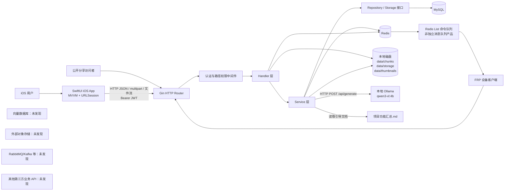

## 2.2 模块数据流

1. iOS 的 View 将事件交给 ViewModel，ViewModel 调用 Feature Service；Service 通过统一 `NetworkClient` 组装 URL、Header、Query 和 Body。
2. Gin 路由先经 JWT/Redis 会话校验和路径权限校验。管理员 JWT 直接跳过普通路径权限检查，管理员子路由再经 `RequireAdmin`。
3. Handler 负责协议解析、参数校验、HTTP 状态码和响应封装；Service 负责业务判断；Repository 通过 GORM 访问 MySQL。
4. 文件二进制不存入 MySQL：分片先写 `data/chunks`，合并后写 `data/storage/YYYYMM`；MySQL `storage` 表仅记录 SHA-256、路径和大小；缩略图写 `data/thumbnails`。
5. Redis 保存登录 token、用户路径权限缓存、公开分享限流计数、FRP 设备状态、命令数据/历史和命令 List 队列。
6. 上传完成后 Go 启动普通 goroutine 异步分析文件：读取物理文件，调用 Ollama，写 `ai_metadata`/`ai_task`，同时尝试自动绑定 Live Photo。
7. AI 结构化搜索最终是 MySQL `LIKE` 检索；自然语言搜索只让模型把问题转成结构化字段，再复用同一 SQL 查询，不是向量检索。
8. FRP “下发”是把命令 ID 写入 Redis List，设备通过轮询接口 `LPOP` 拉取；没有独立消息代理和推送通道。

# 三、技术栈

| 模块 | 技术 | 职责与实际用法 |
|---|---|---|
| 前端 | Swift 5、SwiftUI | iOS UI、导航、状态绑定和 MVVM Feature 分层。 |
| 前端 | Combine / `ObservableObject` | ViewModel 状态发布；项目构建设置默认 MainActor 隔离。 |
| 前端 | URLSession + async/await | JSON、multipart、二进制文件请求；统一由 `URLSessionNetworkClient` 发起。 |
| 前端 | QuickLook / QLThumbnailGenerator | Office/PDF 等本地下载后的系统预览和缩略图生成。 |
| 前端 | AVKit | 视频/音频本地文件播放。当前未调用后端 Range 流接口。 |
| 前端 | Photos / PhotosUI | 选择照片和 Live Photo、保存 Live Photo 到相册。 |
| 前端 | CryptoKit MD5 | 计算上传分片 MD5。 |
| 后端 | Go 1.25 | 服务端语言与跨平台编译目标。 |
| 后端 | Gin 1.12 | 路由、中间件、JSON/multipart/流式响应。 |
| 后端 | GORM 1.31 + MySQL driver | ORM、事务、查询和启动时 `AutoMigrate`。 |
| 后端 | JWT v5 + bcrypt | HS256 token、密码哈希；兼容历史明文密码并在登录时升级。 |
| 数据库 | MySQL / InnoDB / utf8mb4 | 用户、文件元数据、存储索引、协作、FRP、AI 元数据、设置和日志。SQL dump 标记源版本 9.6.0。 |
| 缓存 | Redis 9 client | token 白名单、权限缓存、分享限流、FRP 状态和 Redis List 命令队列。 |
| 文件存储 | 本地文件系统 | 分片、去重后的物理文件、缩略图；不是 S3/MinIO/OSS。 |
| AI | Ollama `/api/generate` | 本地模型推理。默认模型 `qwen3-vl:4b`，120 秒超时。 |
| AI | goexif | 从图片读取 GPS、拍摄时间、相机信息。 |
| AI | ledongthuc/pdf + ZIP/XML 读取 | PDF 和 OpenXML 文档文本提取。 |
| 部署 | Makefile、Bash、Go 交叉编译 | 生成 macOS/Linux amd64/arm64 二进制与 tar.gz；支持版本 ldflags。 |
| 配置 | `.env` / godotenv / plist / CLI | 后端环境变量与端口/数据目录覆盖；iOS API Base URL 和超时。 |
| 工具 | Xcode project | iOS Debug/Release、单元测试和 UI 测试 target。测试内容当前仅模板。 |

未发现：Web 前端、Android 客户端、MongoDB 实际连接、外部对象存储、向量数据库、Embedding 服务、独立消息队列、容器编排、CI/CD、OpenAPI 文件。

# 四、目录结构解析

## 4.1 仓库顶层

```text
cloudnest/
├── cloudnest_go/                 # Go 后端、文档、构建脚本和已生成发布包
├── cloudnest_ios/                # Xcode 工程与 SwiftUI 客户端
├── *.md                          # iOS 页面方案、任务计划、模块映射、按钮说明
├── outputs/                      # 演示 PPT 与生成中间产物（当前未跟踪）
├── patch_vm.swift                # 开发过程补丁/临时文件（未纳入 Xcode target）
└── cloudnest.sql                 # 不在仓库；本次输入位于 Desktop
```

仓库还跟踪了若干 `patch*.swift`、`test_context_menu*.swift/.o`、二进制和 tar.gz，它们不是运行时分层的一部分。

## 4.2 Go 后端

| 目录/文件 | 责任 |
|---|---|
| `cmd/server/main.go` | 读取 `.env`、应用 CLI 覆盖、创建数据目录、连接 MySQL/Redis、种子管理员、启动 Gin。 |
| `internal/app/container.go` | 依赖组装和全部 83 条路由注册。 |
| `internal/config` | 环境配置结构和默认值。 |
| `internal/auth` | JWT 生成与解析。 |
| `internal/middleware` | Bearer token、Redis token 存活、权限缓存/匹配、管理员检查。 |
| `internal/handler` | 相当于 controller；负责 HTTP DTO、参数校验、状态码、流式文件响应。 |
| `internal/service` | 业务编排：权限、文件、协作、设置、FRP、Live Photo、AI、日志、容量。 |
| `internal/service/contract` | Repository/事务/日志接口和跨层 DTO/错误，降低 service 对 GORM 实现的直接依赖。 |
| `internal/storage/mysql` | 相当于 mapper/repository；GORM 查询、事务和持久化实现。 |
| `internal/store` | MySQL/Redis 客户端初始化、AutoMigrate、默认管理员种子。 |
| `model/models.go` | 相当于 entity；21 个 GORM 模型。SQL 另有一个未映射的 `role_file_scope` 表。 |
| `data` | 运行时本地对象数据根目录。 |
| `docs` | iOS API 文档、部署说明和存储层迁移记录。 |
| `scripts/release.sh`、`Makefile` | 构建和四平台发布打包。 |
| `dist`、`main` | 已生成的二进制/发布包，不是源代码。 |

代码没有独立 `controller`、`mapper`、`entity`、`common`、`utils`、`ai` 目录；对应职责分别落在 `handler`、`storage/mysql`、`model` 和各 service/handler 内的私有 helper 中。AI 是 `ai_handler.go + ai_service.go + ai_repo.go`，不是独立目录。

后端主调用关系：

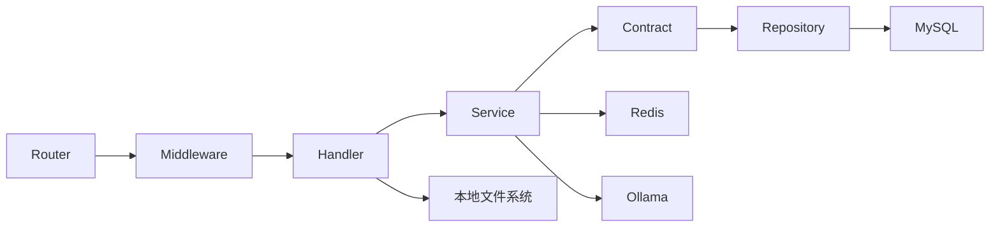

## 4.3 iOS 客户端

| 目录/文件 | 责任 |
|---|---|
| `cloudnest_iosApp.swift` | SwiftUI 应用入口。 |
| `ContentView.swift` | 登录态门面与首页/文件/传输/设置四 Tab。 |
| `App/DependencyInjection` | 单例环境配置和网络客户端组装。 |
| `App/Application`、`App/Routing` | 目录存在但当前无实际源码。 |
| `Core/Network` | Endpoint 协议、HTTP method、统一 URLSession client、错误映射。 |
| `Core/Components` | Liquid Glass 主题和通用 Feature 卡片。 |
| `Core/Storage`、`Extensions`、`Utils`、`Constants` | 目录存在，当前无实现文件。 |
| `Features/Auth` | 登录、局域网/外网地址探测、会话写入。 |
| `Features/Home` | 并发加载文件、Live Photo、FRP、速率窗口、容量概览。 |
| `Features/Files` | 文件浏览、搜索、目录树、上传、下载、预览、分享、回收站、Live Photo。 |
| `Features/Transfers` | 内存态上传/下载任务列表、暂停/恢复 UI；下载流程尚未接入任务管理。 |
| `Features/FRP` | 设备/映射基础管理与保存 YAML。 |
| `Features/Settings` | 创建用户、系统设置、速率时间窗、权限摘要、工作区和文件协作。 |
| `Features/AdminLogs` | 日志筛选、分页和 CSV 导出。 |
| `Features/Smart` | AI 全接口模型/服务/ViewModel；当前独立 View 只展示自然语言搜索且无主导航入口。 |
| `Features/Profile` | 占位服务与简单页面，未接真实 API且无导航入口。 |
| `Shared/Managers` | UserDefaults 会话、Tab 切换通知。 |
| `SupportingFiles/Environments` | plist 环境和运行时 Base URL 覆盖。 |
| `Resources` | 规划目录，目前大多为空。 |

iOS 调用关系为 `View -> ViewModel -> Feature Service -> NetworkClient -> Go API`。DTO 通常定义在每个 Feature 的 `Models` 或 `Services` 文件内。

# 五、数据库设计

## 5.1 表清单

SQL dump 共 22 张表；Go AutoMigrate 管理其中 21 张。下表以 SQL 为数据库事实基线，并标注代码漂移。

| 表 | 作用 | 主键 | 主要字段 | 关系/备注 |
|---|---|---|---|---|
| `user` | 用户账号 | `id` | username、password、email、status、create/update_time | username 唯一；被角色、文件、空间、设备等引用。 |
| `role` | 系统角色 | `id` | role_name、description | role_name 唯一。 |
| `user_role` | 用户与角色多对多 | `id` | user_id、role_id | FK 到 user/role，删除级联；缺少 `(user_id,role_id)` 唯一约束。 |
| `user_path_permission` | 用户 HTTP 路径权限 | `id` | user_id、path、method、create_time | `(user_id,path,method)` 唯一；SQL 未声明 user FK。 |
| `role_file_scope` | 角色可访问根文件范围 | `id` | role_id、root_file_id、allow_read/write/download | SQL 存在且有 FK；Go 无模型、无 Repository、无运行时使用。 |
| `workspace` | 团队工作区 | `id` | name、owner_id、create_time | owner_id -> user。 |
| `workspace_user` | 工作区成员角色 | `id` | workspace_id、user_id、role | `(workspace_id,user_id)` 唯一；角色字符串 owner/admin/member。 |
| `file` | 文件/目录元数据 | `id` | user_id、filename、parent_id、is_folder、file_type、size、storage_id、workspace_id、current_version、is_deleted | user/storage/workspace FK；parent_id 是逻辑自关联但无 FK。 |
| `storage` | 去重物理文件索引 | `id` | file_hash、file_path、file_size、create_time、ref_count | SHA-256 唯一；SQL 有 ref_count 和触发器，Go `Storage` 模型没有 ref_count。 |
| `upload_task` | 分片上传任务 | `id` | upload_id、user_id、filename、total_size、chunk_size、total_chunks、uploaded_chunks、status | upload_id 唯一；SQL 无 user FK。 |
| `upload_chunk` | 已上传分片 | `id` | upload_id、chunk_index、chunk_size、chunk_path、status | `(upload_id,chunk_index)` 唯一；与 upload_task 是字符串逻辑关系，无 FK。 |
| `share` | 文件分享链接 | `id` | file_id、user_id、share_code、expire_time、create_time | share_code 唯一；FK 到 file/user。 |
| `file_permission` | 文件级协作权限 | `id` | file_id、user_id、permission | permission enum(read/write/download)；代码只授予 read/write，download 只出现在表枚举。 |
| `file_version` | 文件版本历史 | `id` | file_id、version、storage_id、size、create_user、comment、create_time | `(file_id,version)` 唯一；引用 file/storage/user。 |
| `live_photo` | 图片与 MOV 的绑定 | `id` | image_file_id、video_file_id、create_time | 两列均引用 file；数据库没有去重唯一约束。 |
| `device` | FRP 设备 | `id` | user_id、device_name、device_ip、status、create_time | user_id -> user。 |
| `frp_mapping` | FRP 端口/域名映射 | `id` | device_id、local_port、remote_port、domain、status | remote_port 唯一；device 删除级联。domain 未建唯一索引，代码前置检查。 |
| `frp_config` | FRPC YAML 历史 | `id` | device_id、config_text、create_time | device_id -> device；删除设备没有声明级联。 |
| `ai_metadata` | 文件 AI 索引 | `id` | file_id、tags、description、ocr_text、create_time | file 删除级联；file_id 未设唯一。 |
| `ai_task` | AI 调用/自动分析记录 | `id` | user_id、file_id、task_type、status、result、create_time | 引用 user/file；当前更像事件记录而非可更新任务。 |
| `operation_log` | 操作审计 | `id` | user_id、file_id、action、status、detail、client_ip、create_time | 仅索引，无 SQL 外键，避免主体删除阻塞日志。 |
| `system_setting` | 全局及按用户拼接键的设置 | `id` | setting_key、setting_value、description | setting_key 唯一；个人高峰窗口使用 `_user_{uid}` 后缀。 |

`storage.ref_count` 由 SQL 中三个 file INSERT/UPDATE/DELETE 触发器维护，只统计 `is_deleted=0` 的引用。若仅靠 GORM AutoMigrate 新建数据库，这个字段和触发器不会由当前 Go 模型创建。

## 5.2 ER 图

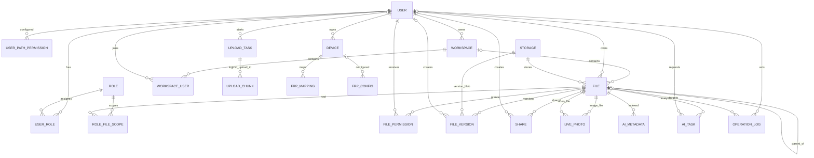

说明：`FILE -> FILE`、`UPLOAD_TASK -> UPLOAD_CHUNK` 是代码使用的逻辑关系，不是 SQL 外键；ER 图其余关系以 dump 外键或明确业务引用为依据。

# 六、业务流程

## 6.1 用户登录

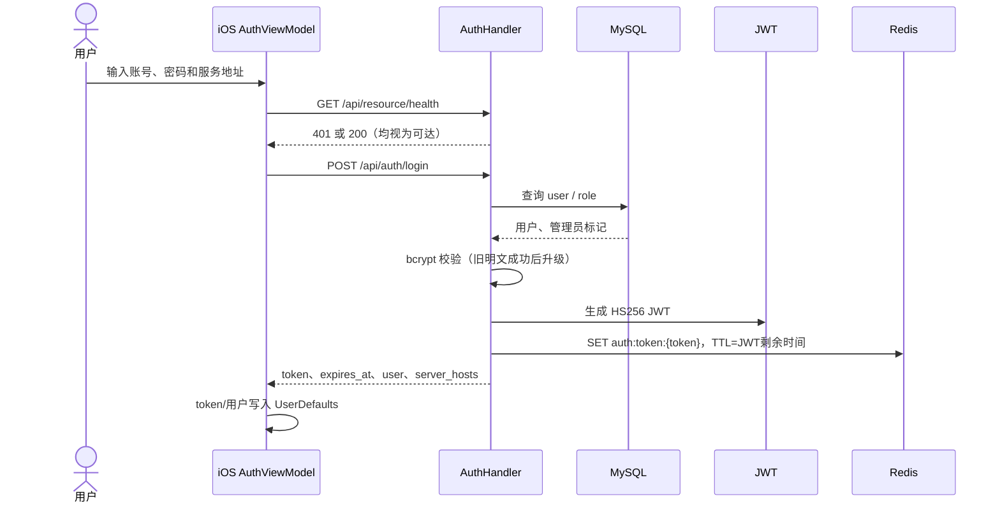

## 6.2 权限校验

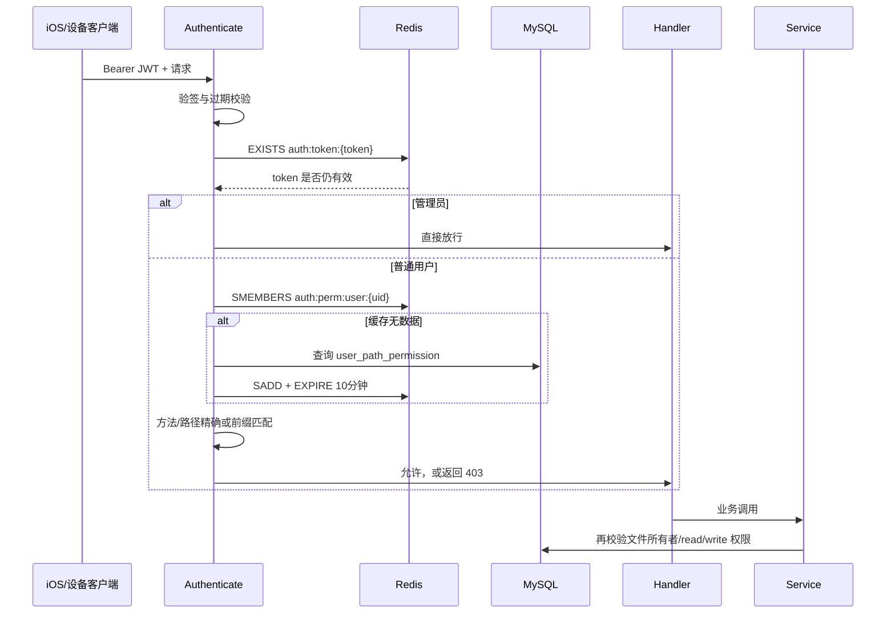

路径权限是 API 级门禁，文件权限是资源级门禁，两者并存。普通用户没有任何自定义路径权限时走默认允许策略（`/api/admin*` 与 `/api/settings/permissions` 除外）；一旦配置任意路径权限，逻辑变为显式匹配列表。

## 6.3 分片上传、入库、自动 AI 与 Live Photo

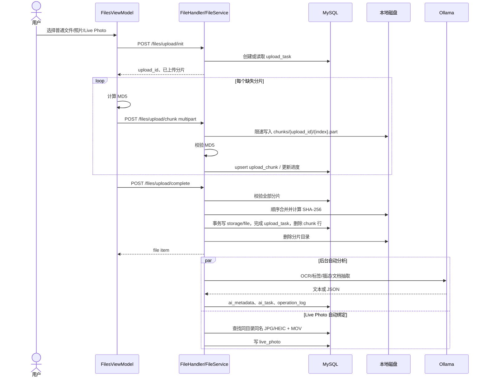

## 6.4 文件分享与公开下载

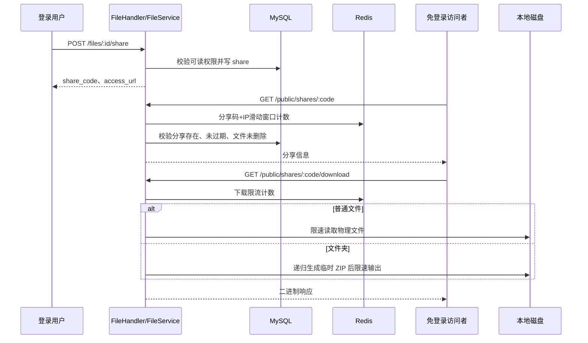

## 6.5 AI 问答流程

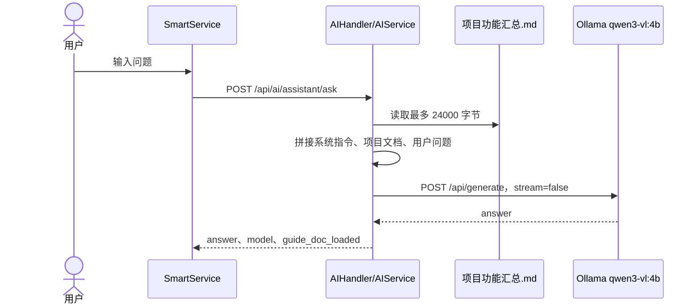

该流程是“整段文档注入 Prompt”，没有切块、Embedding、向量召回或引用来源，因此不是标准 RAG。

## 6.6 自然语言文件检索

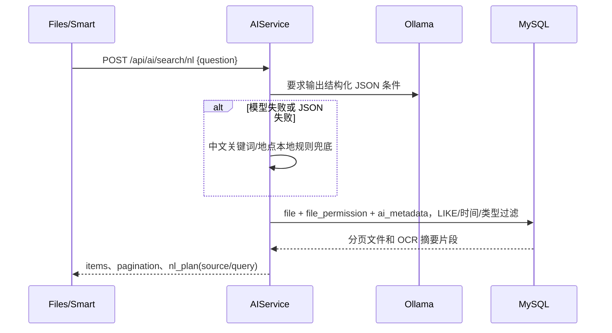

## 6.7 文件协作与版本提交

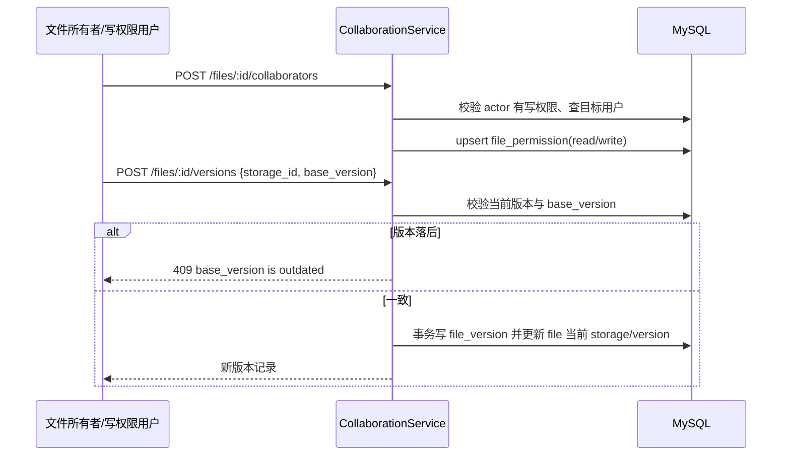

当前版本接口要求调用者先提供已有 `storage_id`；代码没有“上传新版本二进制并返回 storage_id”的专用 API，iOS 也没有版本 UI。

## 6.8 FRP 配置下发与结果回传

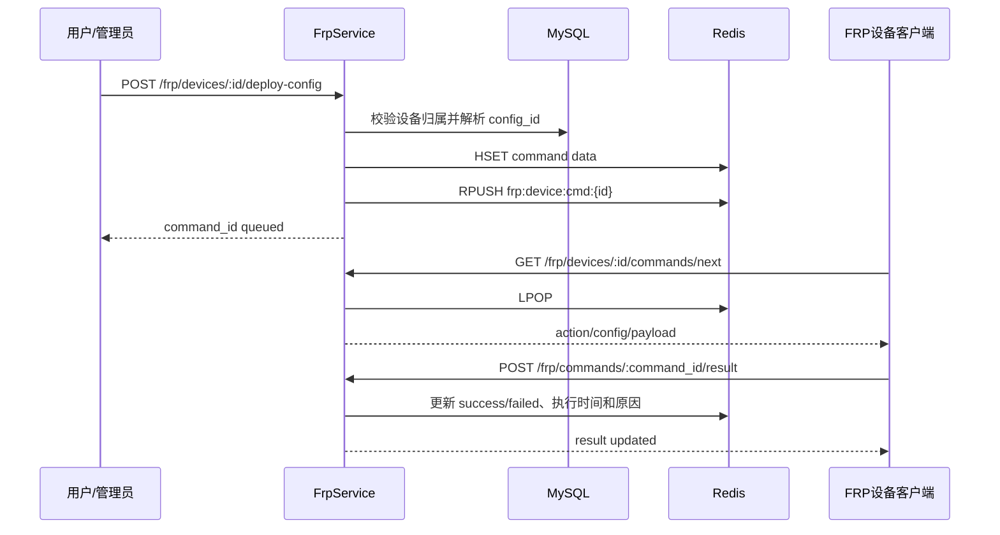

“评分流程”：当前项目没有评分表、评分 API、评分 Service 或前端评分页面，无法画出事实时序图。

# 七、接口总结

## 7.1 通用约定与调用关系

- 默认地址：`http://127.0.0.1:8080`；统一前缀 `/api`。
- 除登录和两条 public share 路由外，均要求 `Authorization: Bearer <token>`。`/api/resource/health` 也是受保护路由。
- JSON 成功响应常用 `item`、`items`、`message`、`pagination`；文件接口返回二进制或 CSV；错误为 `{"error":"..."}`。
- 所有路由的后端调用链均为 `Gin Router -> Authenticate/RequireAdmin -> Handler -> Service -> Repository/Redis/本地磁盘/Ollama`。
- 下表“iOS”表示当前代码中存在实际调用封装或直接请求；“后端”表示后端已注册但 iOS 当前无对应调用。

## 7.2 认证、公共与健康检查

| 方法与 URL | 参数 | 主要返回 | 当前调用 |
|---|---|---|---|
| `POST /api/auth/login` | JSON username、password | token、expires_at、user、server_hosts | iOS 登录 |
| `POST /api/auth/logout` | Bearer | message | iOS 设置页 |
| `GET /api/auth/me` | Bearer | user 详情和 is_admin | 后端 |
| `GET /api/resource/health` | Bearer；登录探测不带 token 时返回 401 | message | iOS 登录前可达性探测 |
| `GET /api/public/shares/:code` | path code；按 code+IP 限流 | share_code、expire_time、file | 后端 |
| `GET /api/public/shares/:code/download` | path code；按 code+IP 限流 | 文件流或目录 ZIP | 后端 |

## 7.3 文件、上传、下载与预览

| 方法与 URL | 参数 | 主要返回 | 当前调用 |
|---|---|---|---|
| `GET /api/files` | query parent_id=0 | items(file) | iOS 文件页/首页 |
| `POST /api/files/folders` | JSON parent_id、name | item(folder) | iOS |
| `PUT /api/files/:id/rename` | path id；JSON name | item(file) | 后端 |
| `DELETE /api/files/:id` | path id | message | 后端（iOS 用 batch-delete） |
| `POST /api/files/upload/init` | upload_id?、parent_id、filename、total_size、chunk_size?、total_chunks? | upload_id、uploaded_chunks/count、status | iOS |
| `POST /api/files/upload/chunk` | multipart upload_id、chunk_index、chunk_md5、chunk | message | iOS |
| `POST /api/files/upload/complete` | upload_id、parent_id | item(file) | iOS |
| `GET /api/files/upload/progress` | query upload_id | 总/已传/缺失分片、progress、status | 后端 |
| `GET /api/files/search` | parent_id、name、file_type、start_time、end_time、page、limit | items + pagination | iOS |
| `GET /api/files/:id/download` | path id | attachment 文件流，限速 | iOS |
| `GET /api/files/:id/download-zip` | path id | 目录 ZIP，限速 | iOS |
| `POST /api/files/batch-download` | JSON file_ids | 总 ZIP，限速 | 后端 |
| `POST /api/files/batch-delete` | JSON file_ids | deleted_ids、failed map | iOS |
| `GET /api/files/:id/stream` | path id；支持 Range | 200/206 视频流 | 后端 |
| `GET /api/files/:id/thumbnail` | path id；query size 64..1024 | JPEG 缩略图 | iOS |
| `POST /api/files/move` | file_ids、target_parent_id | updated_ids | iOS |
| `POST /api/files/copy` | file_ids、target_parent_id | new_ids | iOS |
| `GET /api/files/recycle-bin` | 无 | items | iOS |
| `POST /api/files/:id/restore` | path id | item(file) | iOS |
| `DELETE /api/files/:id/permanent` | path id | message | iOS |
| `GET /api/files/:id/preview` | path id | 文本返回 JSON；图片/PDF/视频/Office 返回 inline 文件 | iOS |

## 7.4 分享与审计

| 方法与 URL | 参数 | 主要返回 | 当前调用 |
|---|---|---|---|
| `POST /api/files/:id/share` | expire_hours?；0 永不过期 | share_code、expire_time、相对 access_url | iOS |
| `GET /api/shares` | 无 | items(share) | iOS |
| `DELETE /api/shares/:code` | path code | message | iOS |
| `GET /api/operation-logs` | action、status、start_time、end_time、page、limit、all | items + pagination | iOS |
| `GET /api/operation-logs/export` | 同上，limit 最大 5000 | CSV | iOS |

## 7.5 工作区、文件权限和版本

| 方法与 URL | 参数 | 主要返回 | 当前调用 |
|---|---|---|---|
| `POST /api/workspaces` | name | item(workspace) | iOS 设置页 |
| `GET /api/workspaces` | 无 | 可访问 workspace items | iOS |
| `POST /api/workspaces/:id/members` | user_id? 或 username、role(admin/member) | message | iOS |
| `GET /api/workspaces/:id/members` | path id | items(member + username) | iOS |
| `PUT /api/workspaces/:id/members/:user_id` | role(admin/member) | message | 后端（iOS 添加成员时用 POST upsert） |
| `DELETE /api/workspaces/:id/members/:user_id` | path ids | message | iOS |
| `POST /api/files/:id/collaborators` | user_id? 或 username、permission(read/write) | message | iOS 设置页 |
| `GET /api/files/:id/collaborators` | path id | items(user + permission) | iOS |
| `DELETE /api/files/:id/collaborators/:user_id` | path ids | message | iOS |
| `POST /api/files/:id/versions` | storage_id、base_version、comment?、size?、file_type? | item(file_version)；冲突 409 | 后端 |
| `GET /api/files/:id/versions` | path id | items(version history) | 后端 |

## 7.6 设置、容量与管理员

| 方法与 URL | 参数 | 主要返回 | 当前调用 |
|---|---|---|---|
| `GET /api/settings` | 无 | system_setting items；普通用户敏感值脱敏 | iOS |
| `PUT /api/settings` | items[{setting_key,value,description}]；管理员 | message | iOS（UI 未按管理员隐藏） |
| `GET /api/settings/permissions` | query all=1 仅管理员 | scope、roles、user_roles、workspace_roles、file_permissions | iOS（普通用户默认会被路径中间件拒绝） |
| `GET /api/settings/rate-window` | 无 | item(enabled/start/end/source) | iOS |
| `PUT /api/settings/rate-window` | enabled?、start、end | message | iOS |
| `GET /api/storage/overview` | 无 | used/total/remaining bytes、percent、quota source | iOS 首页 |
| `POST /api/admin/users` | username、password、email?、role_name?、permissions[] | id、username | iOS 设置页 |
| `PUT /api/admin/users/:id/permissions` | permissions[{method,path}] | message | 后端 |

## 7.7 FRP

| 方法与 URL | 参数 | 主要返回 | 当前调用 |
|---|---|---|---|
| `POST /api/frp/devices` | device_name、device_ip? | item(device) | iOS |
| `GET /api/frp/devices` | query status? | items(device) | iOS 首页/FRP |
| `GET /api/frp/devices/:id` | path id | device、mapping_count、latest_config_time | 后端 |
| `PUT /api/frp/devices/:id` | device_name?、device_ip?、status? | item(device) | iOS 仅 status |
| `DELETE /api/frp/devices/:id` | path id | message | iOS |
| `POST /api/frp/mappings` | device_id、local_port、remote_port?、domain?、status? | item(mapping) | iOS |
| `GET /api/frp/devices/:id/mappings` | path id | items(mapping) | iOS |
| `PUT /api/frp/mappings/:id` | local_port?、remote_port?、domain?、status? | item(mapping) | 后端 |
| `DELETE /api/frp/mappings/:id` | path id | message | iOS |
| `POST /api/frp/configs/preview` | device_id、server_addr、server_port?、token? | device_id、config_text | 后端 |
| `POST /api/frp/configs/save` | 同上 | item(frp_config) | iOS，另存本地 YAML |
| `GET /api/frp/devices/:id/configs` | path id | items(config history) | 后端 |
| `POST /api/frp/configs/:id/rollback` | path config id | item(new copied config) | 后端 |
| `POST /api/frp/devices/:id/deploy-config` | config_id? | queued message、command_id、config_id | 后端 |
| `POST /api/frp/devices/:id/reload` | 无 | queued message、command_id | 后端 |
| `POST /api/frp/devices/:id/status/report` | online、heartbeat、errors、client_version、current_config_id? | message | 后端/设备客户端协议 |
| `GET /api/frp/devices/:id/status` | path id | online、heartbeat、last_error、version、updated_at、config_id | iOS |
| `GET /api/frp/devices/:id/commands/next` | path id | item(command) 或 null | 后端/设备客户端协议 |
| `POST /api/frp/commands/:command_id/result` | success、result_message、failure_reason、executed_at | message | 后端/设备客户端协议 |
| `GET /api/frp/devices/:id/commands` | query limit<=100 | items(command history) | 后端 |

## 7.8 Live Photo

| 方法与 URL | 参数 | 主要返回 | 当前调用 |
|---|---|---|---|
| `POST /api/live-photos/bind` | image_file_id、video_file_id | item(relation + files) | 后端 |
| `POST /api/live-photos/auto-bind` | parent_id?、file_ids?；至少一个 | summary、created_items、skipped_items | iOS 上传 Live Photo |
| `DELETE /api/live-photos/:id` | path id | message | 后端 |
| `GET /api/live-photos/:id` | path id | item(relation + files) | 后端 |
| `GET /api/live-photos` | parent_id、page、limit | items + pagination | iOS 首页 |
| `GET /api/files/:id/live-photo` | path file id | item + file_role，或 null | iOS 文件页 |

## 7.9 AI

| 方法与 URL | 参数 | 主要返回 | 当前调用 |
|---|---|---|---|
| `POST /api/ai/ocr` | file_id、location?、landmark?、captured_at?、tags?、description? | metadata、EXIF、doc_summary | iOS Service 有封装，当前可达 UI 不直接触发 |
| `GET /api/ai/search` | keyword、file_type、location、landmark、start/end_time、tag_only、page、limit | items + pagination | iOS Service 有封装，当前主要 UI 用 NL search |
| `POST /api/ai/search/nl` | question、page?、limit? | items、pagination、nl_plan | iOS 文件统一搜索 |
| `POST /api/ai/summarize` | file_id、max_points? | summary item | iOS Service/ViewModel 有封装，无主导航入口 |
| `POST /api/ai/assistant/ask` | question | answer、model、guide_doc_loaded | iOS Service/ViewModel 有封装，无主导航入口 |
| `POST /api/ai/assistant/settings` | setting_key、setting_value、description?；管理员 | message | iOS Service/ViewModel 有封装，无主导航入口 |

API 文档列出了 82 条业务接口；代码另有 `/api/resource/health`，所以路由实际总数为 83。文档没有 OpenAPI schema，参数/响应仍靠手写 DTO 维持一致。

# 八、AI 相关模块

| 能力 | 当前事实与职责 |
|---|---|
| 模型 | 默认 `qwen3-vl:4b`，由 Ollama 提供；环境变量可覆盖模型名和地址。没有多模型路由或模型版本锁定。 |
| Prompt | 代码内硬编码五类核心 Prompt：图片 OCR；OCR 文本 3-5 点摘要；上传后标签/描述 JSON；自然语言转检索 JSON；文档关键点+总览；另有项目助手 Prompt。 |
| OCR | 图片原始字节 Base64 后作为 Ollama `images` 发送；结果写 `ai_metadata.ocr_text`。EXIF 信息作为 tags/description 补充。 |
| 文档抽取 | 文本类直接读；PDF 用 PDF 库；docx/xlsx/pptx 解 ZIP 并去 XML 标签。摘要读取上限 2 MiB，索引截到 100000 字节。 |
| 自动标注 | 上传完成的 goroutine 对图片/文档生成 tags、description、ocr_text，写 `ai_metadata` 和 `ai_task`。不支持格式会只写基础标签/描述。 |
| 结构化检索 | MySQL `LIKE` 搜索 filename/tags/description/ocr_text，加文件类型、时间和权限过滤。 |
| 自然语言检索 | 模型只生成 keyword/file_type/location/landmark/start/end_time JSON；失败时按城市、旅游、照片、发票、MacBook 等本地规则兜底。 |
| 项目问答 | 每次读取引导 Markdown（最多 24000 字节）并整体拼进 Prompt。 |
| Embedding | 未发现模型、依赖、表字段或调用。 |
| RAG | 未实现标准 RAG；项目问答属于整文 Prompt 注入，文件搜索属于关系库 LIKE 查询。 |
| 向量检索/向量库 | 未发现 Milvus、Qdrant、pgvector、Pinecone、Weaviate 等依赖或配置。 |
| 重排序 | 未发现 reranker 或二阶段排序；结果按 `f.id DESC`。 |
| Agent | 未发现工具调用循环、计划器或 agent runtime。AI 设置接口只是管理员直接写设置，不是 Agent。 |
| MCP | 未发现 MCP server/client、manifest 或工具调用。 |
| AI 任务 | `ai_task` 记录 processing/success/failed 事件；代码创建新行而非更新同一任务状态。 |

# 九、目前已经完成的功能

## 9.1 后端已存在完整代码路径

- 用户名密码登录、JWT、Redis token 会话、退出、当前用户信息。
- 默认管理员种子、管理员创建用户和替换路径权限。
- 路径权限缓存、默认权限策略、文件所有者/read/write 二级权限校验。
- 文件/目录列表、新建、重命名、软删除、移动、递归复制、回收站恢复与彻删。
- 分片初始化、MD5 校验、续传状态、合并、SHA-256 内容去重、上传/下载限速。
- 单文件/目录/批量下载、Range 视频流、图片缩略图、文本/媒体/Office 基础预览。
- 分享创建、列表、撤销、免登录查看/下载、分享访问限流。
- 文件名/类型/时间搜索、操作日志查询与 CSV 导出。
- 工作区、成员角色、文件协作者和基于 base_version 的版本冲突控制。
- 系统设置白名单/值校验、个人高峰时段、容量概览。
- FRP 设备、映射、配置预览/保存/历史/回滚、Redis 命令队列、状态/结果回传。
- Live Photo 手动/自动绑定、列表、详情、反查和解绑。
- OCR、EXIF、自动标签/描述、自然语言检索、文档摘要、项目问答、AI 设置写入。
- macOS/Linux 四架构构建和 tar.gz 发布脚本。

## 9.2 iOS 已存在并可编译的功能

- 登录、外网地址输入、局域网地址发现、会话持久化和退出。
- 首页容量、FRP 状态、近期 Live Photo/文件聚合。
- 文件目录/面包屑/树形选择、列表与网格、搜索筛选、多选操作。
- 文件选择器/相册上传、分片 MD5 上传、照片和 Live Photo 成对上传。
- 文件/目录下载、QuickLook、图片、视频/音频、Live Photo 预览。
- 分享管理、回收站、移动、复制、批量删除。
- FRP 设备/映射基础 CRUD、状态展示、生成并保存 frpc.yaml。
- 系统设置、个人高峰时段、用户创建、工作区/成员、文件协作者、日志 CSV。
- 文件页同时执行普通文件名搜索和 AI 自然语言搜索。
- TransferManager 的上传任务状态、暂停/恢复内存模型和 UI。

# 十、尚未完成的功能

以下结论来自占位代码、空事件、无入口或缺失调用，不把文档规划当成实现。

- Home 右上角搜索按钮 action 为空。
- 独立 `SmartView` 没有主导航入口；其 UI 目前只显示自然语言搜索，OCR/摘要/问答/设置虽在 ViewModel 中但没有当前 View 控件。
- `ProfileService` 明确标注占位，Profile 页面无真实 API且无入口。
- `PhotosView` 明确写“后续继续完善”，且当前主 Tab 是“传输”而非“照片”。
- 文件单项重命名、普通单项删除、批量下载 API、上传进度 API、视频 Range stream API 没有 iOS 调用。
- iOS 下载没有接入 `TransferManager`，因此“下载”分段通常不会出现真实下载任务；通用文件上传也没有注册可恢复 execution block。
- 文件版本创建/历史没有 iOS UI；也缺少新版本二进制上传到 storage_id 的专用闭环。
- 公开分享链接没有 iOS 内置访问/下载页面，当前主要是生成链接。
- FRP 配置预览、历史、回滚、部署、reload、命令历史、设备侧拉取/上报没有 iOS 管理 UI；设备 Agent 程序也不在仓库。
- FRP 规划中的启动/停止、带宽/连接数/24h 流量、告警、证书、token 轮换、灰度下发、诊断导出未实现。
- `role_file_scope` 表没有进入 Go 权限逻辑；“按角色限制可访问根目录”未落地。
- `file_permission.download` 枚举未形成独立下载权限判断；当前读取通常接受 read/write。
- 自动回收站保留天数清理、上传最大并发、上传分片阈值仅可配置但没有完整运行时执行逻辑。
- 容量配额目前只用于概览，不阻止超额上传。
- 分享提取码、次数限制、访问日志；回收站删除人/原路径快照；设置变更历史/回滚均未实现。
- 没有评分功能、Embedding、向量库、RAG、reranking、Agent、MCP。
- 没有有效自动化测试覆盖、OpenAPI、CI/CD、容器部署和生产可观测性。

# 十一、项目存在的问题

本节只记录问题，不修改代码。

## 11.1 TODO / 明确占位

- Profile 服务为占位实现。
- Photos 页面文案明确说明排序、选择、Live Photo 详情待完善。
- FRP deploy/reload 的注释仍标为“预留”，虽已能入 Redis 队列，但缺仓库内设备执行端。
- 权限中间件 `defaultAllowPath` 明确预留未来按 HTTP method 限制。
- iOS 通用文件分片大小硬编码 5 MiB，注释说明后续从设置读取。

## 11.2 潜在 Bug / 行为不一致

- iOS `SessionManager` 只判断字段存在，不解析 `expiresAt`；冷启动可能先进入主界面，直到请求 401 才暴露失效，而且网络层没有全局 401 -> logout 机制。
- iOS 不保存 `is_admin`，设置页无管理员态判断，却始终展示创建用户和保存全局设置等管理员操作；普通用户会持续收到 403。
- `/api/settings/permissions` 在中间件默认策略中特别禁止普通用户，但项目说明又写普通用户可查看自己的权限摘要；当前 iOS 普通用户刷新设置页会触发失败。
- iOS 图片判定包含 HEIC，后端 thumbnail 支持集合不含 HEIC/HEIF，HEIC 缩略图请求会失败；失败被静默吞掉。
- `/files/:id/preview` 对文本返回 JSON，iOS 将响应原样写成原文件扩展名后交给 QuickLook，内容会包含 JSON 包装而非原始文本。
- iOS 媒体预览下载整个文件后播放，没有使用已实现的 `/stream`；大视频无法真正边下边播。
- 上传 init 接受调用方提供的正数 `total_chunks`，没有强制等于 `ceil(total_size/chunk_size)`；complete 也未核对合并大小等于声明 `total_size`，错误元数据可能被标记完成。
- 完成上传未检查同目录重名，目录创建/重命名会检查但上传可产生重复文件名，规则不一致。
- `ai_metadata.file_id`、Live Photo 文件组合、`user_role(user_id,role_id)` 缺数据库唯一约束；业务层“先查后写”在并发下仍可能重复。
- 文件/AI 搜索连接 `file_permission` 后没有 `DISTINCT`；如果同一文件/用户存在多条权限行，可能重复计数和返回。
- AI `ApplySetting` 直接写任意 key/value，绕过 `SettingsService` 的白名单和范围校验，与普通设置接口规则不一致。
- `ai_task` 的 processing/success/failed 通过新增多条记录表达，没有更新同一 task；如果 UI 将其当任务状态表，语义会混乱。
- SQL `storage.ref_count`/触发器与 Go 模型/AutoMigrate 漂移；不同建库方式会得到不同能力。
- SQL `role_file_scope` 存在但应用完全忽略，容易让数据库配置产生“看似生效、实际不生效”的误解。

## 11.3 安全与运维风险

- `.env.example` 包含看起来像真实环境的 MySQL/Redis 明文凭据；即便是示例文件，也不应保留可用秘密。
- 启动会自动创建 `admin/admin`，且默认 JWT secret 是弱占位值；部署者忘记覆盖时风险很高。
- iOS 将 Bearer token 保存到 UserDefaults，而不是 Keychain。
- 默认开发地址使用明文 HTTP；代码未包含 TLS 终止、反向代理安全配置或 HSTS 证据。
- FRP 设备上报和拉命令复用用户 JWT，没有设备独立密钥、签名、轮换或最小权限认证。
- Gin 未显式配置 trusted proxies；审计/限流依赖 `ClientIP()` 时需结合真实反向代理部署验证。
- 没有优雅停机、连接池显式配置、健康/就绪检查分层和服务指标。
- 数据库 dump 位于开发者 Desktop 而不是受版本控制的 migration；仅靠 AutoMigrate 无法复现外键、ref_count 和触发器。

## 11.4 技术债

- `ai_handler.go` 仍保留与 `ai_service.go` 重复的大量 AI helper；FileHandler 还临时构造 AIHandler 调 helper，Handler 边界未完全收口。
- `file_handler.go` 超过 2100 行，混合 HTTP、文件 I/O、ZIP、缩略图、限速和 AI 触发。
- Swift `FilesView.swift` 超过 2200 行，包含大量页面、UIKit/Photos/QuickLook bridge 和上下文菜单逻辑。
- 多个空规划目录、patch 文件、`.o`、二进制和发布包被提交，增加仓库体积与认知噪声。
- API 文档手写且少了 health；没有 OpenAPI 和客户端代码生成，DTO 漂移风险高。
- 后端没有测试；iOS Tests/UITests 基本是 Xcode 模板，关键上传、权限、版本、FRP 并发都没有回归保护。
- 当前 iOS deployment target 为 26.2，兼容范围非常窄；是否符合产品目标没有文档决策。

## 11.5 性能与容量风险

- AI 搜索对长 `ocr_text` 使用前后通配 `LIKE`，无全文/向量索引，数据量增长后会全表扫描。
- 上传后每个文件创建无持久化的 goroutine；服务重启会丢任务，没有并发上限、重试、幂等 worker 或背压。
- 图片 OCR/自动分析使用 `os.ReadFile` 读取整张图片并 Base64，可能造成明显内存放大。
- iOS `request` 将下载完整读入 `Data` 再写磁盘；大文件会占用大量内存。
- iOS 目录树按目录逐层串行请求，最大深度 8，属于 N+1 网络调用。
- 文件列表会逐个请求 Live Photo 关系，再逐个/串行请求缩略图；目录文件多时请求量线性增长。
- 目录 ZIP 和批量 ZIP 在服务端临时磁盘完整生成，超大目录可能占满磁盘；没有可见的临时空间配额。
- 缩略图采用 Go 手写最近邻像素循环，超大图片 CPU 成本较高，且只生成 JPEG。
- 物理文件彻删策略没有垃圾回收：代码明确不删除去重存储物理文件，长期运行可能持续占用磁盘；SQL ref_count 也没有配套清理任务。
- 容量上限只展示不执行，攻击者或误操作可继续写满磁盘。

# 十二、理解后的项目总结

CloudNest 的核心不是单一“网盘页面”，而是一套以私有部署为前提的文件服务。当前系统的主干已经形成：iOS 负责用户交互，Go 提供 HTTP API，MySQL 保存关系与元数据，Redis保存短生命周期状态，本地磁盘保存真正的文件内容，Ollama提供本地 AI 推理。这个组合体现了项目对“数据留在本地”和“移动端可用”的偏好。文件内容不进入数据库，数据库只保存路径与哈希；同内容文件通过 SHA-256 复用 storage 行。这个设计适合单节点自托管，但目前还没有抽象成可替换的对象存储，因此横向扩容和多节点一致性不在现有能力内。

身份系统采用 JWT 加 Redis 白名单。JWT 提供身份声明和过期时间，Redis 决定 token 是否仍可使用，从而支持主动退出。管理员由 role 关系解析并写入 JWT。普通用户还要经过 HTTP 路径权限校验：权限表把 method 与 path 组合成规则，Redis 缓存十分钟。进入业务后，文件模块再次校验文件所有者或 file_permission。这说明项目有两层权限：第一层控制“能不能调用某类 API”，第二层控制“能不能操作某个文件”。工作区角色目前主要用于成员管理；文件访问仍主要依赖文件所有者与显式 file_permission。SQL 中的 role_file_scope 尚未接入，所以设计文档所说的“按角色限制根目录范围”还没有成为真实规则。

文件模块是目前最完整也最复杂的部分。目录使用 file.parent_id 组成树，根目录用 0 表示；目录和文件共表，通过 is_folder 区分。删除默认是软删除，回收站恢复遇到重名会自动改名，彻删会删元数据但不删去重物理对象。上传采用 upload_task/upload_chunk：客户端初始化任务、逐片计算 MD5、服务端限速落盘并校验、全部完成后合并并计算 SHA-256。数据库事务写入 storage/file 并结束任务，相同 SHA-256 会复用已有 storage。下载支持单文件、目录 ZIP、批量 ZIP、速率限制和视频 Range；预览覆盖文本、图片、PDF、视频及 Office 文件的基础 inline 响应。iOS 当前却会把文件整体读入内存，视频也没有走 Range，因此服务端能力与移动端使用方式尚未完全对齐。

协作不是实时共同编辑，而是“授权 + 乐观版本控制”。文件所有者或写权限用户可以授予 read/write；提交版本时携带 base_version，如果已落后则返回 409。新版本记录引用另一个 storage_id，同时更新 file.current_version 和当前 storage。这一模型符合项目说明，但缺少从“编辑后的二进制”到“新 storage_id”的客户端专用上传闭环，iOS 也没有版本界面，所以后端数据能力存在，产品流程尚未完成。团队 workspace 支持 owner/admin/member 和成员管理，但 workspace 与文件的实际创建/归属入口仍较弱。

分享与审计已经形成可用闭环。登录用户创建随机分享码，免登录访问者可查信息或下载，服务端用 Redis 按分享码、IP、动作限流。目录分享会现场生成 ZIP。上传、删除、权限、FRP、AI 设置等动作写 operation_log，并可分页查询或导出 CSV。当前表没有提取码、次数限制和分享访问日志，因此分享能力仍是简单公开链接模型。

FRP 模块不只是生成 YAML：它已有设备、映射、配置历史、回滚、状态上报和命令状态机。设备/映射/配置持久化到 MySQL；瞬时在线状态和命令放 Redis。所谓“下发”并非服务端主动连接设备，而是 Redis List 排队，设备轮询 next 接口取命令，再回传执行结果。这个实现可以支持最小闭环，但仓库里没有 FRP 设备 Agent，且设备使用用户 JWT，没有独立设备认证。流量监控、告警、证书、token 轮换和灰度发布仍是规划。

AI 能力走的是务实的关系库增强路线。图片 OCR 使用 qwen3-vl:4b，多模态输入为 Base64 图片；EXIF 的 GPS、时间、相机信息被合并进标签和描述。文档摘要支持文本、PDF 和部分 OpenXML，通过提取正文再让模型总结。上传完成后后台 goroutine 自动写 tags、description 和 ocr_text。结构化搜索是 MySQL LIKE，自然语言搜索只是先让模型产生查询条件，失败时用本地规则兜底。项目助手每次把项目功能文档整体放进 Prompt。由于没有 Embedding、向量库、分块、召回和重排，这套实现不能称为标准 RAG；它的优点是依赖少，缺点是 OCR 文本增大后查询性能和语义召回能力有限。

iOS 使用 SwiftUI + MVVM Feature 分层。统一网络层、环境配置和 Feature Service 已搭好，核心文件页面功能丰富，支持文件选择器、相册、Live Photo、QuickLook、AVKit 和上下文菜单。首页能聚合容量、FRP 与近期内容；设置页集中了用户、权限、协作、系统设置和审计；FRP 页覆盖基础管理。当前主导航已经从早期文档的“智能/照片”方案变化为“首页/文件/传输/设置”。Smart 独立页虽存在但不可达，AI 搜索被整合进文件页；Photos 与 Profile 仍是占位或孤立模块。传输模块对上传有效，但下载没有真正接入任务模型。

从工程成熟度看，两端均能编译，后端路由覆盖很广，也已有跨平台发布包；但缺少自动化测试、正式 migration、OpenAPI、CI/CD、生产配置和运行观测。安全上还存在示例凭据、默认 admin/admin、UserDefaults 存 token、弱默认 JWT secret 等必须在部署前处理的问题。数据库 dump 与 GORM 模型也不完全一致。综合判断：项目已经越过纯演示壳阶段，属于“核心场景可开发联调、部分高级模块只完成后端或基础 UI、尚未达到可证明生产就绪”的阶段。

## 仍然不了解、需要补充的信息

以下问题无法从现有代码和文档确定：

1. CloudNest 的正式目标用户究竟是个人、家庭、小企业，还是三者都要支持；首发场景和优先级是什么？
2. 当前真实部署拓扑、域名、TLS/反向代理、MySQL/Redis/Ollama 所在主机和备份方案是什么？
3. `/Users/xingyuzhao/Desktop/cloudnest.sql` 是否是唯一权威 schema；生产建库是导入 SQL 还是只运行 AutoMigrate？
4. `role_file_scope` 和 `file_permission.download` 是否仍属于正式需求，还是已经废弃？
5. 默认管理员账号在实际部署中由什么流程改密或禁用？仓库 `.env.example` 中的凭据是否已经轮换？
6. “对象存储”未来是否计划接 MinIO/S3/OSS，还是确定只支持单机本地磁盘？
7. FRP 设备 Agent 的代码、认证方案和运行平台在哪里；命令轮询协议是否已有外部实现？
8. iOS 正式最低系统版本是否确认为 26.2；是否需要兼容更早版本？
9. 当前主导航最终方案是“传输”还是“照片/智能”；Smart、Photos、Profile 是否计划保留？
10. 普通用户是否应该读取 `/api/settings/permissions`；设置页哪些区域必须仅管理员可见？
11. 文件版本的新二进制如何产生 storage_id；是否计划专用版本上传接口？
12. 上传容量配额、回收站自动清理和物理存储垃圾回收的正式策略是什么？
13. AI 的可接受响应时间、并发量、失败重试策略和模型部署硬件是什么？
14. 是否确定要演进到 Embedding/RAG/向量库；如果要，目标数据规模和检索质量指标是什么？
15. 是否有未放入仓库的接口测试、真机测试、验收报告、线上日志或性能数据？
16. 项目是否存在“评分”需求；现有材料中完全没有该领域定义。
